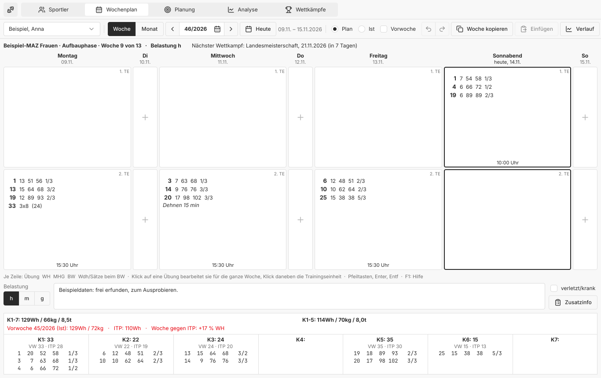
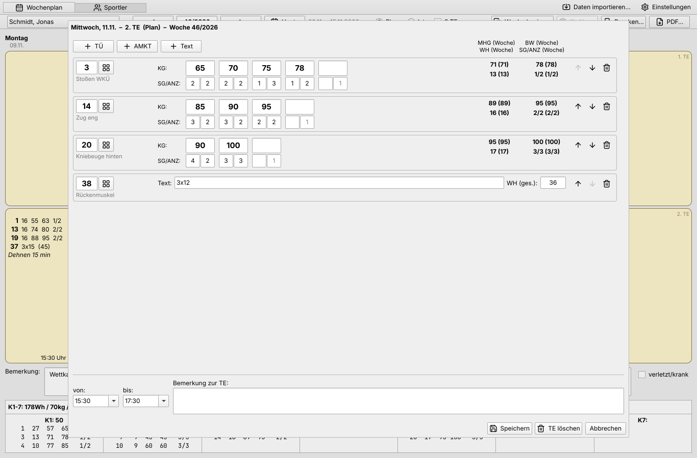
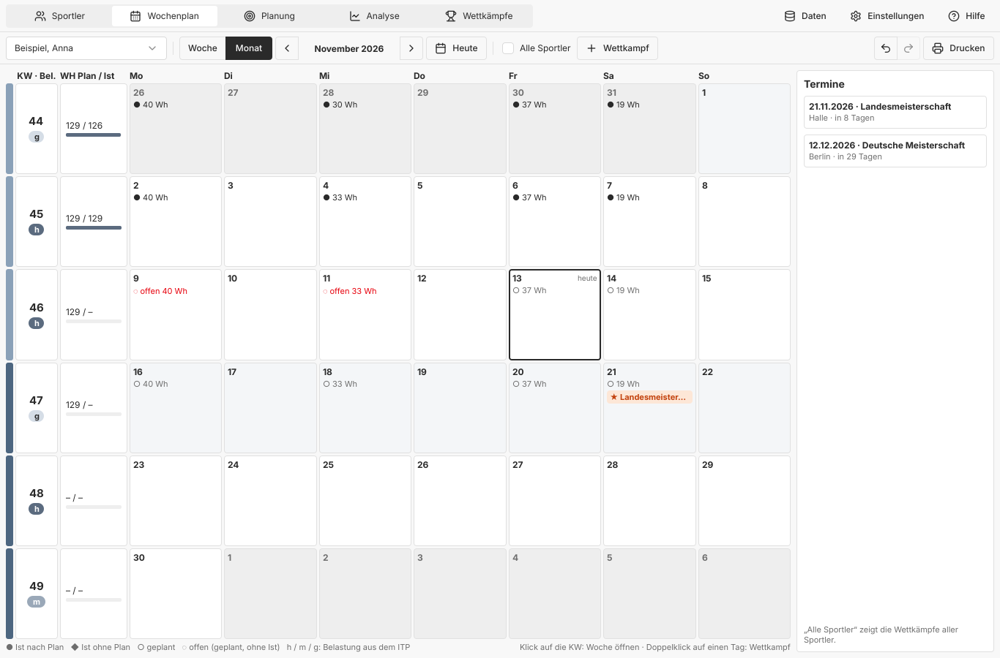
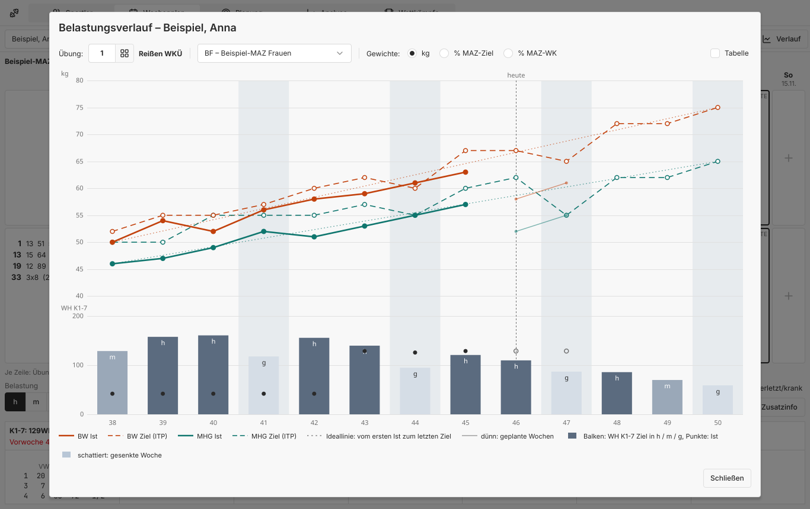
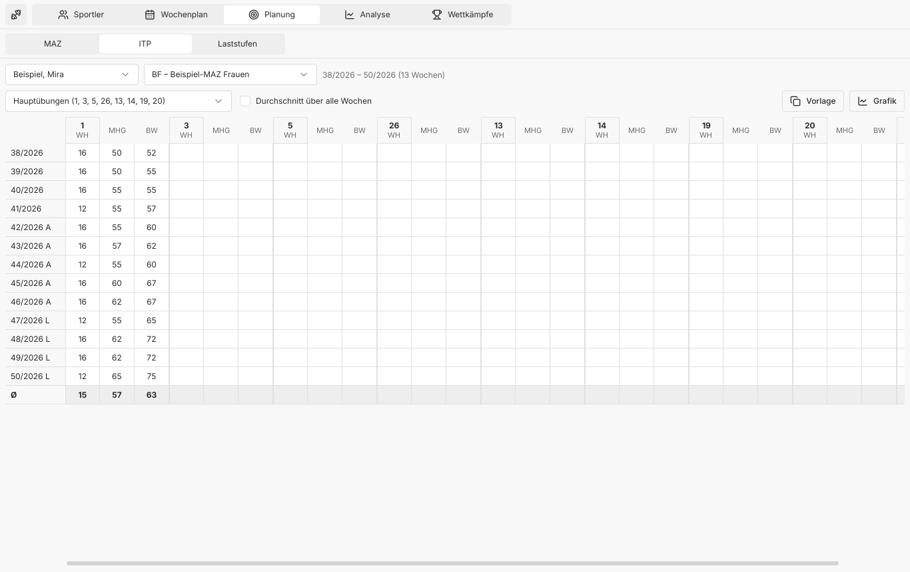

# Trainingsplaner

Weekly training planning for weightlifting coaches: week plans, the load
figures WH, MHG and BW, and printed plans.

**[Website](https://iam-peter.github.io/trainingsplaner/)** ·
**[Download](https://github.com/iam-peter/trainingsplaner/releases)** ·
[Nightly](https://github.com/iam-peter/trainingsplaner/releases/tag/nightly)



Built with Qt 6 (C++ and Qt Quick); data lives in a single SQLite file.
The user interface is in German.

## Download

Each [release](https://github.com/iam-peter/trainingsplaner/releases) has:

| File | For |
|---|---|
| `trainingsplaner-windows-x64-setup.exe` | Windows 10/11: installer, no administrator rights needed |
| `trainingsplaner-windows-x64.zip` | Windows 10/11 without installing: unzip, start `trainingsplaner.exe` |
| `trainingsplaner-macos.dmg` | macOS, Apple silicon and Intel |
| `trainingsplaner-linux-x64.AppImage` | any Linux |
| `trainingsplaner-linux-x64.deb` | Debian and Ubuntu, with its own Qt |

The programs aren't signed: Windows SmartScreen asks once (*Weitere
Informationen*, *Trotzdem ausführen*). macOS blocks the first start; then
choose *Dennoch öffnen* under System Settings › Privacy & Security.

**Windows installer.** It puts the program into a fixed folder
(`%LOCALAPPDATA%\Programs\Trainingsplaner`, or Program Files when
installed for all users), offers two checkboxes for a Start menu entry
and a desktop shortcut (both ticked) and registers an uninstaller under
Windows' *Apps*. The uninstaller offers a checkbox to delete the data as
well (unticked). Step-by-step guides for every system are on the
[website](https://iam-peter.github.io/trainingsplaner/#installation).

**Updates.** At start, at most once a day, the program asks GitHub for the
latest release and shows a bar when there is a newer one. Installed with
the Windows installer, *Jetzt aktualisieren* downloads the new installer,
checks its SHA-256 against the one GitHub publishes, runs it silently and
starts the new version. On macOS, Linux and from the zip it opens the
download. The training data stays in the user's profile and survives
updates and uninstalling.

## Features

- **Wochenplan**: per athlete the week as days with their sessions, plan
  or actual ("Ist"). As many sessions a day as the coach uses (1–3, a
  setting; with one, each day lists its own sessions from the top), days
  without sessions narrow. Above the days the week's MAZ, phase, load
  (h / m / g) and the next competition; "Vorwoche" shows the week before
  above it. The K1–K7 summary with last week, the ITP's target and the
  difference. Week note, injured flag, extra info per day (body weight,
  body fat, supplements), copy/paste a whole week (also to another
  athlete).
- **Monat**: the month instead of the week, in place of a paper calendar:
  weeks with their load and reps planned / done, the MAZ's phases, the
  days' sessions (done, done without a plan, planned, open), and
  competitions entered as dates by a double click. The coming
  competitions at the side, "Alle Sportler" for everyone's, printable.
- **Session panel**: a session opens beside the week, not over it (or in a
  window of its own): weight exercises (kg, reps per set "SG", sets "ANZ",
  failed attempts "UG" in actual weeks), general exercises as text with
  total reps (4x12 gives 48), free text lines, times and a note. Each line
  shows the session's and the week's WH, MHG and BW beside last week and
  the ITP. The next weight is proposed by the athlete's usual jump, ↑/↓
  count, earlier lines and texts are offered while typing, "Wie Vorwoche"
  takes last week's session. Saved when another session is chosen; undo
  with Ctrl+Z. What the panel changes is marked in the week.
- **Erfassung TÜ**: click an exercise line to edit that exercise across
  the whole week in the same panel: one row per session, moved to another
  day or session, added or removed; its lines are marked in the week.
- **Belastungsverlauf**: one exercise's weight per week of the MAZ (BW
  and MHG) as the ITP's target, done and planned, with an ideal line, and
  below it the reps of K1-7 in the colours of the weeks' load: the
  sawtooth of raised and lowered weeks. In kg or % of the MAZ target,
  with the table to copy and print.
- **Sportler**: athletes with age, and Kader, Verein, BSP, Bundeswehr and
  trainers with their history over time; a filter by Kader and sex.
- **Wettkämpfe**: results with six attempts (valid/invalid), total, and a
  chart over the years with best results per half year or year, trends
  and the reference total of the athlete's class. For youth athletes the
  rules of the DGJ: its competitions to pick, a warning for a second
  competition in a week up to AK 17, and the DM Jugend norm of the weight
  class against the year's best total (norms editable in the settings).
- **Planung**: macrocycles (MAZ) with phases and athletes' targets; the
  framework plan (RO) in percent, opened from its MAZ; the athlete's
  individual training plan (ITP) per week and exercise or group with the
  week's load as h / m / g; planned weight steps; templates (RO to ITP
  with the athlete's targets).
- **Analyse**: section analysis (WH, MHG, BW, set size with totals and
  trends, in kg or percent of the targets, comparisons, all MAZ, reps per
  weight), group analysis of a MAZ, data check, and charts. Reports show
  at once and follow their settings and the data; *Kopieren* puts them on
  the clipboard for a spreadsheet, *Speichern unter* saves a PDF or a CSV
  for Excel and LibreOffice.
- **Data**: import and export in the old program's format (everything,
  changes since a date including deletions, or one athlete's weeks).
- **Print / PDF** of the week plan with the old print options (notation,
  figures, notes, empty lines, fonts, paper A4, A5 or A3, portrait or
  landscape, margins, logo), of the month, and of all analyses and charts,
  their tables drawn like the old program's reports, each shown in a page
  preview first, as the old program did; charts also as PNG images, with
  the values shown on hover.
- **Everyday use**: keyboard shortcuts (arrow keys, Enter and Delete in
  the week grid, Ctrl+←/→ for weeks or months, Ctrl+C/V for sessions,
  Ctrl+S), undo and redo of every change to sessions, a right-click menu
  with "Ist = Plan" and "Weitere Einheit", "von" kept before "bis" in
  every range, one athlete selection for all pages, light and dark mode
  (following the system or chosen in the settings), a style of its own
  (`style/`), help with a glossary (F1), an About dialog with the
  version, the update check and a link for reporting problems, and
  example data to try the program on the first start.









How the interface came about and where it goes: [docs/UX-PLAN.md](docs/UX-PLAN.md).
What comes next: [docs/ROADMAP.md](docs/ROADMAP.md).

## Data from WinWoTA XP

Users of the older WinWoTA XP 2.61 can bring their data along: export it
there ("Datenexport", option *komplett*, gives `winwotaxp.bak`), then use
**Datei › Importieren** here. The exercise numbers are the same. Rows are
merged by key and timestamp, so importing again is safe.

This is an independent project. It is not affiliated with, endorsed by or
derived from the code of IAT Leipzig, the BVDG or WinWoTA; the names only
describe which program and data format can be imported.

## Building

Requires Qt 6.8 or newer with the modules Quick, QuickControls2, Sql
(SQLite driver), PrintSupport and Widgets, plus CMake 3.21+.

```bash
qt-cmake -S . -B build -G Ninja -DCMAKE_BUILD_TYPE=Release
cmake --build build
ctest --test-dir build
```

For Windows, install Qt with the online installer (MSVC 2022 or MinGW),
open `CMakeLists.txt` in Qt Creator and build *Release*. `windeployqt
--qmldir qml trainingsplaner.exe` makes the folder self-contained.

Each project is one SQLite file (`*.trainingsplaner`); every change is
saved into it at once. *Datei* creates, opens and copies projects
(*Neues Projekt*, *Öffnen*, *Zuletzt geöffnet*, *Speichern unter*), and the
program starts with the one used last. The first one is
`%APPDATA%\Trainingsplaner\Trainingsplaner\trainingsplaner.sqlite`;
the open file is shown under *Einstellungen*. *Speichern unter* makes a
consistent copy, also for a backup. The program opens only a file of its
own table layout (`sql/schema.sql`); one of another version, or any other
file, is refused, not changed.

## Releases

| Workflow | What it does |
|---|---|
| **CI** | builds and tests every push and pull request on Linux |
| **Nightly** | every night with new commits (or by hand): builds and tests on Linux, Windows and macOS, builds the Windows installer (`packaging/windows/trainingsplaner.iss`, Inno Setup) and tests installing, the update check and uninstalling, then replaces the `nightly` pre-release |
| **Promote Release** | run by hand with a version such as `0.2.0`: publishes the current nightly's files as release `v0.2.0` |
| **Website** | publishes `pages/` on GitHub Pages; the page finds the newest release and nightly by itself |

To release: bump `project(... VERSION ...)` in `CMakeLists.txt`, wait for
(or start) the nightly, then run *Promote Release*.

## Command line

| Option | Purpose |
|---|---|
| `--db <file>` | use another project file for this start, without remembering it |
| `--import <file.bak>` | import an old data export and exit |
| `--athlete <id> --week 46/2026` | start with this athlete and week |
| `--page sportler\|planung\|analyse\|wettkaempfe\|einstellungen` | start on that page |
| `--open 1:2`, `ex:8`, `hist:8`, `chart:8` | open a session (day:number) or an exercise's week in the panel, or an exercise's history or chart |
| `--page planung --open maz\|itp\|ro\|laststufen`, `--page analyse --open individual\|group\|check\|chart` | open a tab |
| `--farbschema hell\|dunkel\|klassisch` | light, dark or the old program's colours for this start, regardless of the setting (Einstellungen › Allgemein › Farbschema) |
| `--grab <file.png>` | save a screenshot and exit (for testing) |
| `--check-update` | print the latest release and exit (0 found, 2 GitHub answered without one, 1 unreachable) |

## Code layout

| Path | Content |
|---|---|
| `src/catalog.*` | exercise catalogue (numbers, groups, names) |
| `src/steps.*` | weight step encoding and the load figures |
| `src/model.h` | athletes, sessions, entries, weeks, weekly summary |
| `src/database.*` | SQLite storage |
| `sql/schema.sql` | the database layout; `sqlite3 neu.sqlite < sql/schema.sql` makes an empty database |
| `src/tables.*` | the old program's table and column names for each table, for import, export and the deletion log |
| `src/bakimport.*`, `src/bakexport.*` | import and export in the old program's format |
| `src/exerciseweek.*` | one exercise across a week (Erfassung TÜ) |
| `src/competition.*` | competitions, totals, best results, reference totals |
| `src/planning.*` | MAZ, framework plan, ITP, planned weight steps |
| `src/analysis.*` | section analysis and load tables |
| `src/weekreport.*` | printed / PDF week plan |
| `src/report.*` | analysis reports: headings, notes and tables, printed and as PDF, as text and CSV |
| `src/printpreview.*` | the page preview shown before printing |
| `src/youth.*` | the DGJ's youth rules: age class, weight classes, DM norms, competitions |
| `src/store.*`, `src/planstore.*`, `src/analysisapi.*`, `src/itpmodel.*`, `src/reportmodel.*` | APIs and models for the QML user interface |
| `qml/` | user interface |
| `style/` | the controls' style: `Primitives` (every colour and size once), `TokenInterface` (their roles per colour scheme), `Style` and `StyleCascade` (rules by state and part), and a `*Style` singleton per kind of control with its variants, e.g. `ButtonStyle.ghost` |
| `tests/` | unit tests (`tst_core`) and UI tests (`tst_qml`) |
| `logo/` | icon and desktop entry |
| `fonts/`, `icons/` | Inter, JetBrains Mono and Lucide icons, built into the program |
| `packaging/` | Debian package script |
| `pages/` | website |
| `docs/ROADMAP.md`, `docs/UX-PLAN.md`, `docs/NAVIGATION.md` | what comes next, the UI/UX plan with its background and mock-ups (`docs/ux/`), and the sidebar set aside |
| `docs/screenshots/` | screenshots with invented demo data (the U17 sample plan of the RTK 2019 scaled for the ITP), retaken with `take_screenshots.qml` and `schemes.py` there |
| `.github/workflows/` | CI, nightly, release and website |

### Old storage format

Weight steps are stored in `te_ueb.lststbem` as nine-digit blocks separated
by `;`: `KKK RRR SS F` = kg, reps per set, sets, failed attempts. Example:
`012003030;015003020` = 12 kg 3×3, 15 kg 3×2 → WH 15, MHG 13, BW 15 (3/2).

## Data protection

The program stores personal data of athletes (names, dates of birth,
training). That data stays in the local database file and is never part of
this repository: `.gitignore` excludes data exports (`*.bak`), databases and
generated PDFs. Tests use invented athletes only. When reporting a problem,
do not attach a real database or export.

The only network access is the update check, which sends no training data:
GitHub sees the program version (as user agent) and the IP address. It can
be switched off under Datei › Über den Trainingsplaner.

## Licence

MIT, see [LICENSE](LICENSE). The bundled assets keep their own licences:

- Fonts: [Inter](https://rsms.me/inter/) and
  [JetBrains Mono](https://www.jetbrains.com/lp/mono/), SIL Open Font
  License 1.1 (`fonts/`).
- Icons: [Lucide](https://lucide.dev/), ISC licence (`icons/LICENSE.txt`).
- The program's style (`style/`) started out after
  [shadcn/ui](https://ui.shadcn.com/) (MIT) and its neutral theme tokens;
  it is not affiliated with the shadcn/ui project.
  Its structure (primitives, roles, styles resolved in a cascade) follows
  the controls of Qt Design Studio; the code is this project's own.

The program uses [Qt](https://www.qt.io/) under the LGPL v3. When handing
out a Windows build made with `windeployqt`, Qt stays in separate DLLs as the
LGPL requires; add Qt's licence texts (from the `Licenses` folder of the Qt
installation) to the package.
