# Handbuch Trainingsplaner Gewichtheben

Dieses Handbuch zeigt jede Ansicht des Programms an einem Beispiel. Alle
Bilder und Zahlen stammen aus den **Beispieldaten**, die das Programm selbst
mitbringt. Die Sportler „Beispiel, Mira“ und „Beispiel, Jonas“ sind frei
erfunden. Ihr Makrozyklus folgt der Rahmenorientierung U17 der
Rahmentrainingskonzeption 2019 des BVDG, umgerechnet auf die Zielleistung
der Sportler.

Die Bilder entstanden am 14.11.2026 (Woche 46/2026). Die Beispieldaten
richten sich nach dem Tag, an dem man sie anlegt. Bei Ihnen stehen deshalb
andere Daten und Wochen, der Aufbau ist aber derselbe.

**Inhalt**

1. [Erste Schritte: Beispieldaten und Projekte](#1-erste-schritte-beispieldaten-und-projekte)
2. [Sportler](#2-sportler)
3. [Wochenplan](#3-wochenplan)
4. [Monat und Wettkampftermine](#4-monat-und-wettkampftermine)
5. [Belastungsverlauf](#5-belastungsverlauf)
6. [Planung: MAZ, Rahmenorientierung, ITP, Laststufen](#6-planung-maz-rahmenorientierung-itp-laststufen)
7. [Analyse](#7-analyse)
8. [Wettkämpfe](#8-wettkämpfe)
9. [Einstellungen](#9-einstellungen)
10. [Tastenkürzel](#10-tastenkürzel)
11. [Begriffe](#11-begriffe)

---

## 1. Erste Schritte: Beispieldaten und Projekte

### Willkommen

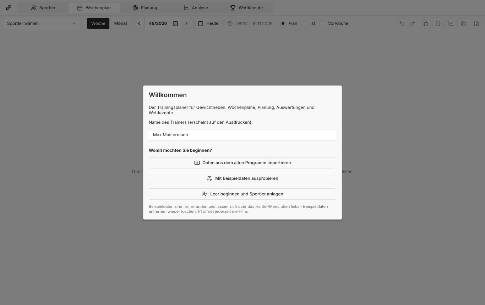

Beim ersten Start fragt das Programm nach dem Namen des Trainers (er steht
auf den Ausdrucken) und womit Sie beginnen möchten:

- **Daten aus dem alten Programm importieren**: liest die Datensicherung
  von WinWoTA XP (`winwotaxp.bak`) ein.
- **Mit Beispieldaten ausprobieren**: legt die beiden Beispiel-Sportler mit
  allem an, was dieses Handbuch zeigt.
- **Leer beginnen und Sportler anlegen**.

### Das Hantel-Menü

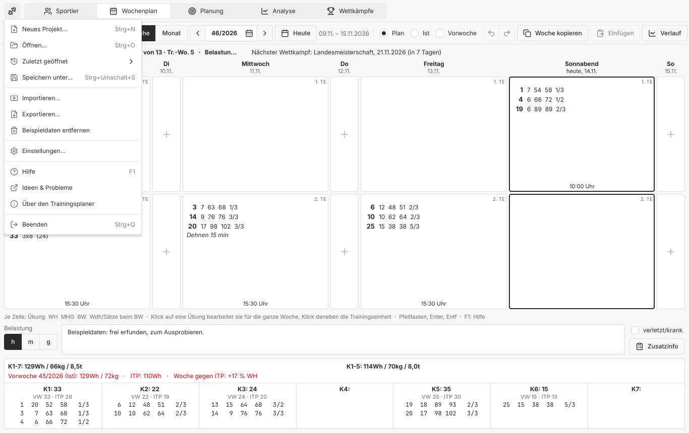

Die Hantel ganz links oben öffnet das Menü für alles, was keine eigene
Seite hat:

| Eintrag | Wozu |
|---|---|
| Neues Projekt… | eine neue, leere Projektdatei anlegen; danach erscheint wieder der Willkommen-Dialog |
| Öffnen… | eine andere Projektdatei öffnen |
| Zuletzt geöffnet | die letzten Projekte, zum schnellen Wechseln |
| Speichern unter… | eine Kopie des Projekts anlegen und darin weiterarbeiten (auch als Sicherung) |
| Importieren… / Exportieren… | Datensicherung im Format des alten Programms lesen oder schreiben |
| Beispieldaten entfernen | löscht die Beispiel-Sportler mit ihrem MAZ; Ihre eigenen Daten bleiben |
| Einstellungen… | siehe [Abschnitt 9](#9-einstellungen) |
| Hilfe, Über den Trainingsplaner | Kurzhilfe (auch F1), Version und Updates |
| Beenden | das Programm schließen |

**Projekte.** Ein Projekt ist eine Datei. Jede Änderung wird sofort darin
gespeichert, einen Knopf „Speichern“ braucht es deshalb nicht. Das Programm
öffnet beim Start das zuletzt benutzte Projekt.

> **Beispiel:** Um die Beispieldaten getrennt von Ihren echten Daten
> anzusehen, wählen Sie *Hantel-Menü › Neues Projekt…* und geben z. B.
> „Beispiel“ als Namen ein. Im Willkommen-Dialog klicken Sie dann *Mit
> Beispieldaten ausprobieren*. Über *Zuletzt geöffnet* kommen Sie jederzeit
> zu Ihren eigenen Daten zurück.

---

## 2. Sportler

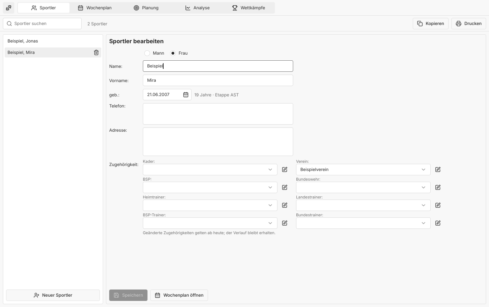

Links steht die Liste der Sportler mit einem Suchfeld darüber, rechts die
Angaben des gewählten Sportlers. **Neuer Sportler** legt einen an,
**Speichern** übernimmt Änderungen, **Wochenplan öffnen** springt zu seiner
Woche.

Unter *Zugehörigkeit* stehen Kader, Verein, Bundeswehr, Heimtrainer usw.
Diese Angaben gelten jeweils ab einem Datum: Das Stift-Symbol daneben zeigt
den Verlauf, z. B. seit wann jemand im Landeskader ist. Eine Änderung gilt
ab heute, der Verlauf davor bleibt erhalten.

Neben dem Alter steht die **Trainingsetappe** des langfristigen
Leistungsaufbaus nach der Altersklasse des Jahres (BVDG/IAT, Factsheet
2024); die Maus darüber nennt die Trainingseinheiten je Woche:

| Etappe | AK | Einheiten je Woche |
|---|---|---|
| AGA – Allgemeine Grundausbildung | bis 13 | 2–3 |
| GLT – Grundlagentraining | 14–15 | 3–5 |
| ABT – Aufbautraining | 16–17 | 5–7 |
| AST – Anschlusstraining | 18–23 | 7–9 |
| HLT – Hochleistungstraining | ab 24 | 7–9 |

Für die AGA nennt das Factsheet keine Zahl; 2–3 sind die des
Trainingsmittelkatalogs 2018 für Kinder.

> **Beispiel:** Mira Beispiel, geboren am 21.06.2007 (19 Jahre, Etappe
> AST), Verein „Beispielverein“.

Der gewählte Sportler gilt für alle Seiten: Wer hier Mira wählt, sieht auch
im Wochenplan, in der Planung und in den Wettkämpfen Mira.

---

## 3. Wochenplan

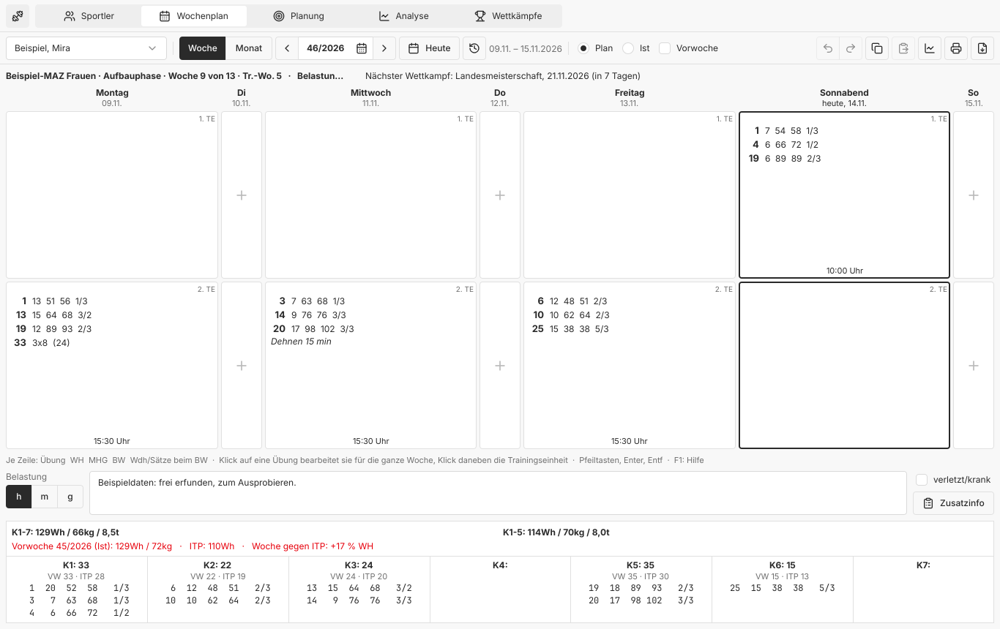

Die wichtigste Seite. Sie zeigt eine Woche eines Sportlers: oben die
Steuerung, in der Mitte die Trainingseinheiten der Tage, unten Belastung,
Bemerkung und die Auswertung der Woche.

### Die Leiste oben

- **Sportler** wählen.
- **Woche / Monat** umschalten (Monat: [Abschnitt 4](#4-monat-und-wettkampftermine)).
- **‹ 46/2026 ›** blättert eine Woche zurück oder vor (auch Strg+← / Strg+→),
  das Kalender-Symbol wählt eine Woche, **Heute** springt zur aktuellen.
- **Plan / Ist**: die geplante oder die tatsächlich trainierte Woche.
- **Vorwoche** zeigt die Woche davor über der aktuellen.
- **Rückgängig / Wiederholen** (Strg+Z / Strg+Y).
- **Woche kopieren / Einfügen** überträgt eine ganze Woche, auch zu einem
  anderen Sportler.
- **Verlauf** öffnet den Belastungsverlauf ([Abschnitt 5](#5-belastungsverlauf)).

Darunter fasst eine Zeile die Woche zusammen:

> Beispiel-MAZ Frauen · Aufbauphase · Woche 9 von 13 · Tr.-Wo. 5 ·
> Belastung h · Nächster Wettkampf: Landesmeisterschaft, 21.11.2026 (in 7 Tagen)

**Tr.-Wo.** zählt wie die Rahmentrainingskonzeption die Trainingswochen
bis zum Hauptwettkampf: 1 ist seine Woche, 2 die davor. Der
Hauptwettkampf ist die Woche mit der WK-Lage **HWK** im ITP (sonst in
der Rahmenorientierung), ohne HWK die letzte Woche des MAZ. Ist das
Fenster schmal, kürzt das Programm die Zeile mit „…“.

### Eine Zeile lesen

In jeder Trainingseinheit (TE) steht je Übung eine Zeile:
**Übung, WH, MHG, BW, Wdh/Sätze beim BW**.

> **Beispiel:** Sonnabend, 1. TE: `1  7  54  58  1/3` heißt
> Übung 1 (Reißen WKÜ), 7 Wiederholungen, mittleres Hantelgewicht 54 kg,
> Bestwert 58 kg, beim Bestwert 1 Wiederholung in 3 Sätzen.

Text-Übungen wie `33 3x8 (24)` (Klimmzüge, 3×8, zusammen 24 WH) und freie
Notizen wie „Dehnen 15 min“ stehen ebenso in der Einheit.

### Eine Trainingseinheit bearbeiten

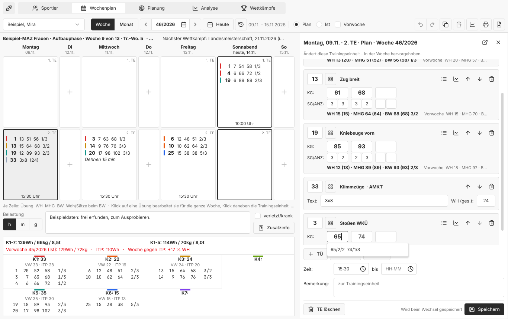

Ein Klick in eine Einheit öffnet sie rechts neben der Woche. Je Übung
stehen dort die Laststufen: oben das Gewicht (KG), darunter
Wiederholungen/Sätze (SG/ANZ).

> **Beispiel:** In Montag, 2. TE wurde mit *+ TÜ* die Übung 3 (Stoßen WKÜ)
> angefügt und 65 kg eingetippt. Das Programm schlägt die folgenden
> Laststufen grau vor; Pfeiltasten (↑/↓) zählen Wiederholungen und Sätze
> hoch und runter, Enter geht weiter.

Unter jeder Übung steht, was sie in der Woche ergibt und was die Vorwoche
und das ITP dazu sagen. *Zeit* und *bis* legen die Uhrzeit fest. Die
Einheit wird beim Wechsel zu einer anderen Einheit oder beim Schließen
gespeichert (sofort mit Strg+S). Jede Änderung lässt sich rückgängig
machen. Das Pfeil-Symbol oben rechts holt die Einheit in ein eigenes
Fenster.

### Eine Übung über die ganze Woche (Erfassung TÜ)

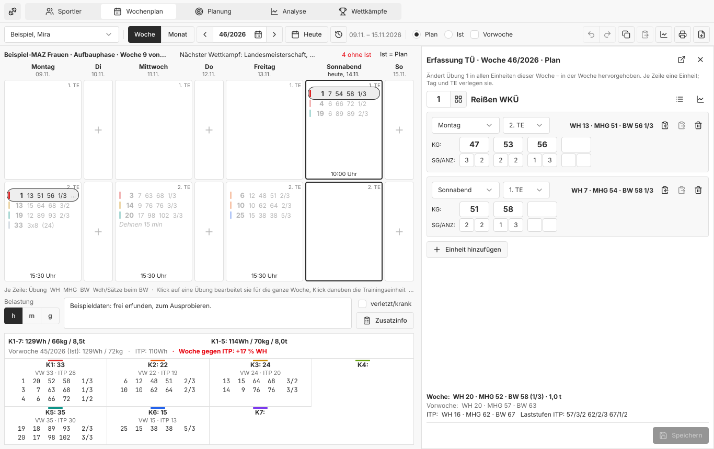

Ein Klick auf eine Übungszeile öffnet **Erfassung TÜ**: diese eine Übung in
allen Einheiten der Woche. In der Woche ist sie hervorgehoben.

> **Beispiel:** Reißen WKÜ steht am Montag (2. TE) und am Sonnabend (1. TE).
> Unten steht die Summe der Woche (WH 20 · MHG 52 · BW 58), daneben
> Vorwoche und ITP zum Vergleich. *Einheit hinzufügen* plant die Übung an
> einem weiteren Tag ein.

### Vorwoche

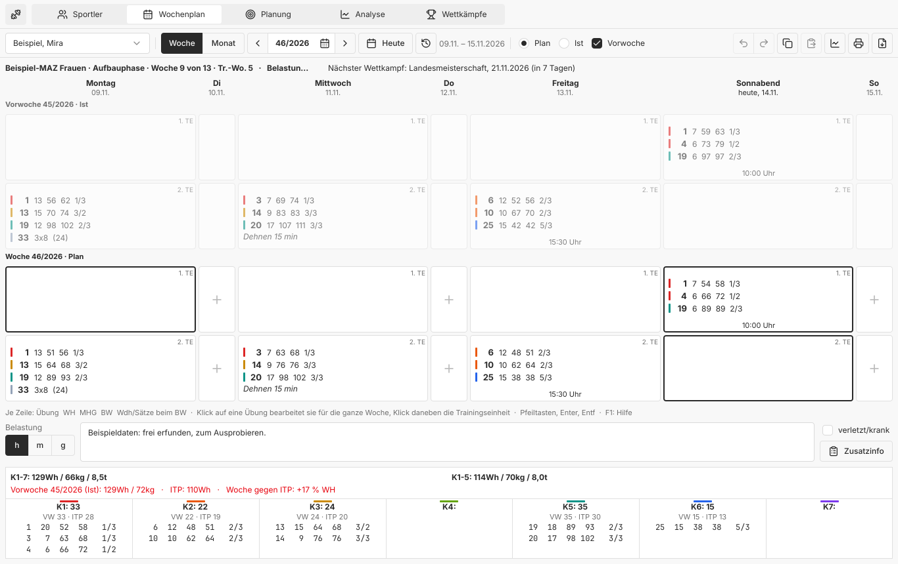

Mit **Vorwoche** steht die Woche davor über der aktuellen. Sie zeigt, was
in der letzten Woche wirklich trainiert wurde (Ist), während Sie die
aktuelle planen.

### Belastung, Bemerkung, verletzt/krank, Zusatzinfo

Unter der Woche:

- **Belastung h / m / g**: die Belastung der Woche (hoch, mittel, gesenkt).
  Es ist derselbe Wert wie im ITP unter „Bel.“, er lässt sich hier oder dort
  setzen. Ein Klick auf den gewählten Buchstaben nimmt ihn zurück.
  *Beispiel: Woche 46 ist „h“.*
- **Bemerkung zur Woche** und **verletzt/krank**.
- **Zusatzinfo**: Körpergewicht, Körperfett, Nahrungsergänzung und andere
  Werte je Tag.

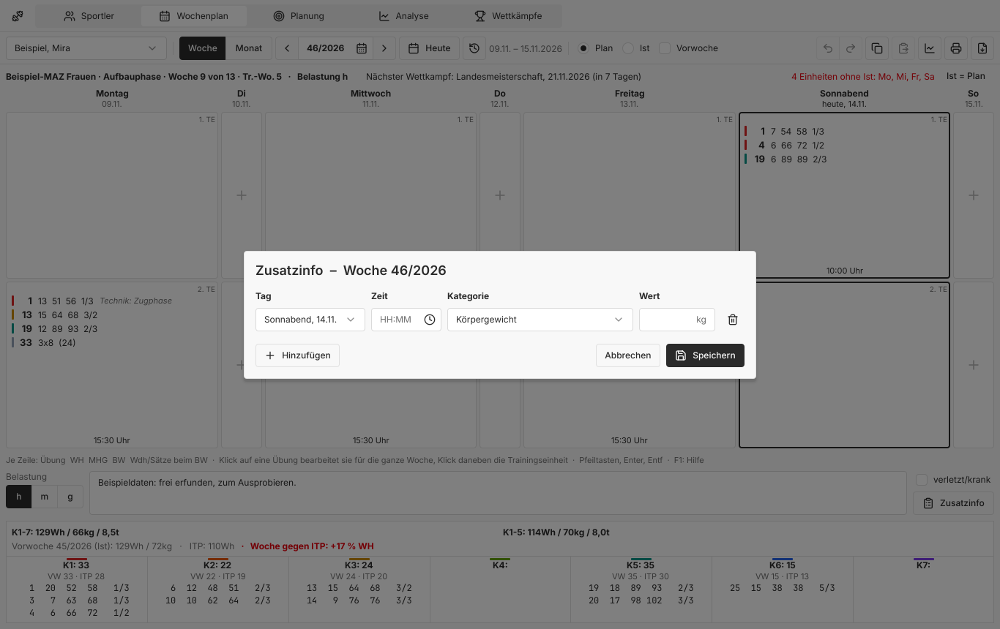

### Die Auswertung der Woche

Ganz unten wertet das Programm die Woche wie das alte Programm aus:

> **Beispiel (Woche 46, Plan):**
> `K1-7: 129Wh / 66kg / 8,5t`: alle Übungsgruppen zusammen 129
> Wiederholungen, im Mittel 66 kg, 8,5 Tonnen bewegt.
> Rot darunter der Vergleich: Vorwoche (Ist) 129 WH / 72 kg, ITP 110 WH,
> die Woche liegt also 17 % über dem ITP.
> Je Gruppe K1 … K7 die Übungen der Gruppe, mit Vorwoche (VW) und ITP:
> `K1: 33 · VW 33 · ITP 28`.

### Drucken

Strg+P (oder Drucken in der Monatsansicht) zeigt zuerst eine
Seitenvorschau wie im alten Programm. Dort lassen sich der Drucker und das
Papier wählen. Was auf dem Ausdruck steht, legen die
[Einstellungen › Ausdruck](#9-einstellungen) fest.

Oben in der Mitte steht klein, wann der Plan gedruckt wurde („erstellt
am 14.11.2026“): so ist klar, welche Fassung an der Wand hängt. Mit
**Tonnage je Übung** bekommt jede Zeile eine Spalte **t**, die bewegte
Last der Zeile in Tonnen. Die **Kennziffern der Woche** nennen neben
K1-7 und K1-5 auch die Wiederholungen der allgemeinen Kraftübungen
(**AMKT**, Gruppen 8 und 9), wenn es welche gibt.

> **Beispiel:** Miras Woche 45/2026 (Ist): Reißen am Montag 13 WH,
> MHG 56, BW 62, t 0,73; in der Woche K1-7 129 WH, K1-5 114 WH und
> AMKT 24 WH (Klimmzüge 3×8).

---

## 4. Monat und Wettkampftermine

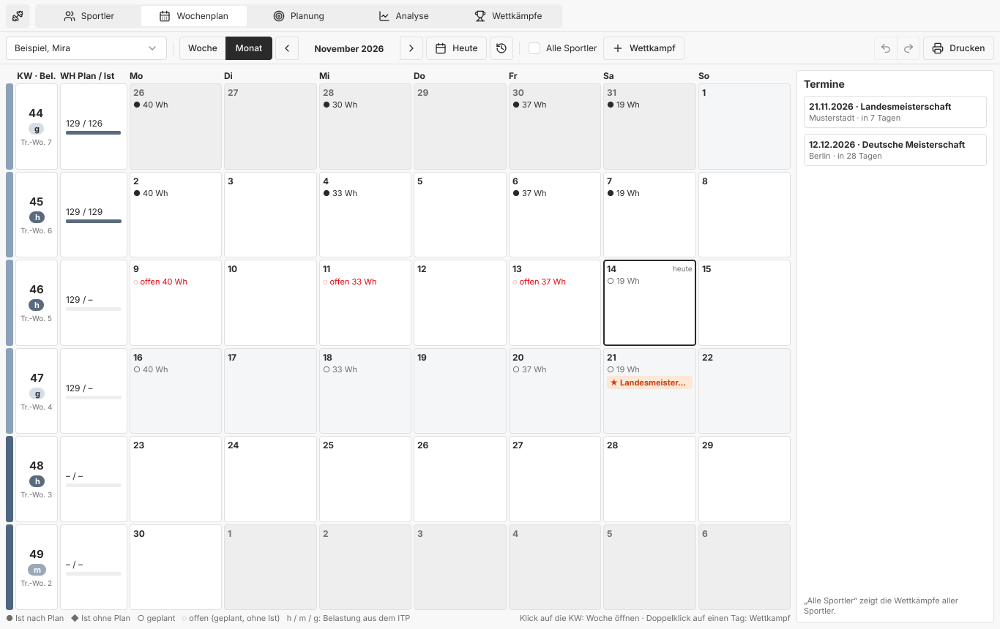

**Monat** zeigt vier bis sechs Wochen auf einmal:

- links je Woche die Kalenderwoche mit ihrer **Belastung** (h/m/g farbig),
  der WK-Lage aus dem ITP (LG, WK, HWK), **Tr.-Wo.** (die Wochen bis zum
  Hauptwettkampf) und den Wiederholungen **Plan / Ist** (`129 / 126`);
- in den Tagen die Einheiten: ● Ist nach Plan, ◆ Ist ohne Plan, ○ geplant,
  ◌ offen (geplant, aber ohne Ist, in Rot);
- rechts die **Termine**, also die kommenden Wettkämpfe.

Ein Klick auf eine Kalenderwoche öffnet diese Woche. **Alle Sportler**
zeigt die Wettkämpfe aller Sportler.

### Einen Wettkampf eintragen

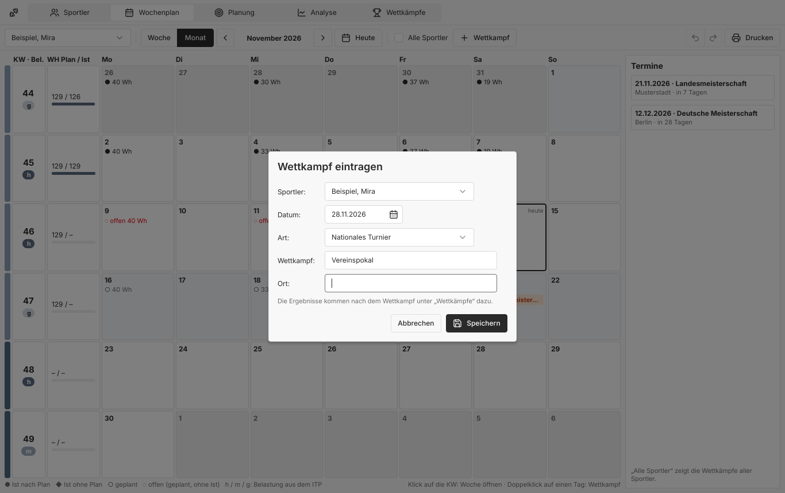

Ein Doppelklick auf einen Tag (oder **+ Wettkampf** oben) trägt einen
Wettkampftermin ein: Sportler, Datum, Art, Name und Ort. Beim Tippen des
Namens schlägt das Programm die Wettkämpfe der DGJ vor (DM Nachwuchs,
DGJ-Supercup, IDJM …). Für Sportler bis AK 17 warnt es, wenn in derselben
Woche schon ein Wettkampf steht. Für AK 14–17 nennt es die Norm der DM
Nachwuchs: für AK 16–17 die der Gewichtsklasse, für AK 14 und 15 die des
Körpergewichts.

> **Beispiel:** Am 28.11.2026 „Vereinspokal“ als Nationales Turnier.
> Die Ergebnisse kommen nach dem Wettkampf unter „Wettkämpfe“ dazu.

---

## 5. Belastungsverlauf

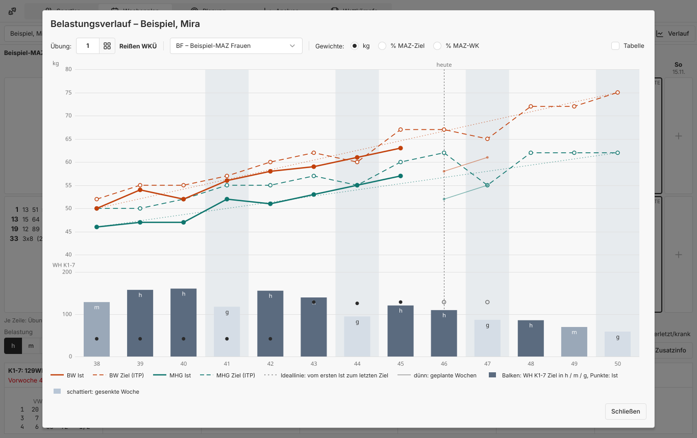

Der Belastungsverlauf zeigt, wie sich Gewicht und Umfang einer Übung über
die Wochen eines Makrozyklus entwickeln, und zwar gegen das, was das ITP
vorsieht. Sie finden ihn an drei Stellen:

- im **Wochenplan** über **Verlauf** (oben rechts);
- in der **Analyse** über **Belastungsverlauf**;
- in der **Planung** unter **ITP** über **Grafik**.

**So lesen Sie ihn**, am Beispiel Mira, Reißen WKÜ, Beispiel-MAZ Frauen
(Wochen 38 bis 50):

- **Oben die Gewichte:** durchgezogen das Ist, gestrichelt das Ziel aus dem
  ITP, rot der Bestwert (BW), grün das mittlere Hantelgewicht (MHG).
  Die gepunktete **Ideallinie** führt vom ersten Ist zum letzten Ziel. Dünne
  Linien rechts sind geplante Wochen.
- **Unten die Balken:** die Wiederholungen K1–K7 laut ITP, beschriftet mit
  der Belastung der Woche (h / m / g). Die Punkte darauf sind das Ist.
- Die violett gestrichelte Linie ist der **Richtwert** des
  Trainingsmittelkatalogs (TMK 2018) für die Wiederholungen K1-7 je Woche
  im Alter des Sportlers: Kinder 200, Schüler 280, Jugend 350, Junioren
  300, U23 320, Senioren 300. Er gilt im Mittel über den Zyklus; die
  hohen Wochen liegen darüber, die gesenkten darunter.
- Über den Balken steht die WK-Lage der Woche (LG, WK, HWK); beim
  Darüberfahren auch Tr.-Wo., die Wochen bis zum Hauptwettkampf.
- **Grau schattiert** sind die gesenkten Wochen (g).
- Die senkrechte Linie **heute** trennt Vergangenheit und Zukunft.

> **Was man sieht:** Die gesenkten Wochen 41, 44, 47 und 50 geben die
> „Sägezahn“-Form: Die Ziel-Gewichte steigen in den hohen Wochen und fallen
> in den gesenkten zurück. Miras Ist (durchgezogen) folgt dem Ziel
> (gestrichelt) bis Woche 45 mit wenigen Kilo Abstand. Ab heute zeigen
> dünne Linien, was für die nächsten Wochen geplant ist.
> Mira ist 2026 in der AK 19, ihr Richtwert liegt bei 300 WH. Die
> erfundenen Beispieldaten planen bewusst weniger, passend zu ihren
> Trainingseinheiten.

Oben lassen sich **Übung** und **MAZ** wählen. **Gewichte** schaltet
zwischen kg, % des MAZ-Ziels und % des Wettkampfergebnisses um.
**Tabelle** zeigt dieselben Zahlen als Tabelle. Beim Darüberfahren
erscheinen die Werte.

---

## 6. Planung: MAZ, Rahmenorientierung, ITP, Laststufen

Die Planung folgt dem Weg der Rahmentrainingskonzeption: erst der
Makrozyklus (MAZ), dann sein Rahmenplan in Prozent (Rahmenorientierung,
RO), daraus der individuelle Trainingsplan (ITP) jedes Sportlers in kg.

### MAZ

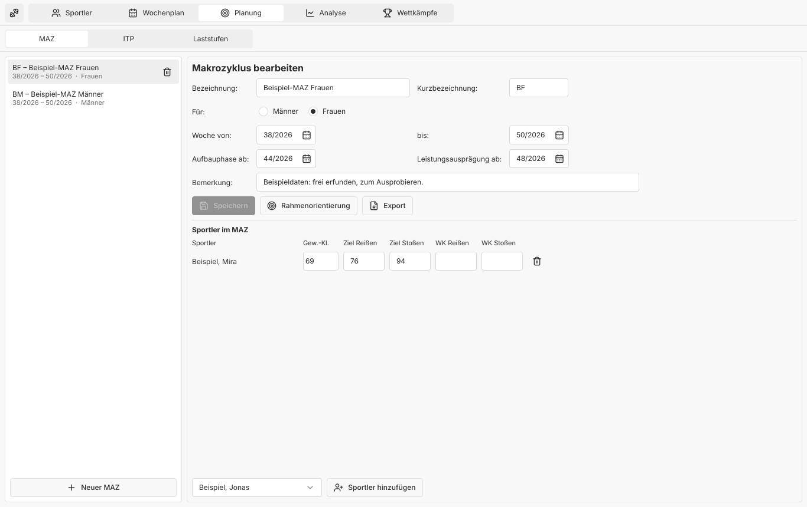

Links die Makrozyklen, rechts der gewählte: Name, Kurzbezeichnung, für
Männer oder Frauen, die Wochen von–bis, Beginn der **Aufbauphase** und der
**Leistungsausprägung**. Darunter die Sportler des MAZ mit Gewichtsklasse
und **Zielleistung** im Reißen und Stoßen.

> **Beispiel:** „Beispiel-MAZ Frauen“ (BF), Wochen 38/2026 bis 50/2026,
> Aufbauphase ab 44, Leistungsausprägung ab 48, wie in der
> Rahmentrainingskonzeption für U17: sechs Wochen Grundlagen-, vier Wochen
> Aufbau- und drei Wochen Leistungsausprägungsphase. Mira:
> Gewichtsklasse 69, Ziel Reißen 76 kg, Stoßen 94 kg.

Neben jedem Sportler steht, wie seine Ziele zur **Entwicklungskurve**
passen: der Gompertz-Kurve nach Sandau (2018) durch die Jahresbesten im
Zweikampf aus den Wettkämpfen vor Beginn des MAZ, für das Jahr seines
Hauptwettkampfs. Liegt das Zweikampf-Ziel mehr als eine Toleranz darüber
oder darunter (das Doppelte des Standardfehlers der Kurve, mindestens
3 % und 3 kg), ist der Hinweis rot. Er ist nur ein Hinweis: das Ziel
bleibt, wie es eingetragen ist. In leeren Zielfeldern steht grau der
**Vorschlag** der Kurve, aufgeteilt wie das letzte Jahresbeste in Reißen
und Stoßen; das Zielscheiben-Symbol übernimmt ihn. Ohne Ergebnisse aus
mindestens vier Jahren gibt es keine Kurve und keinen Hinweis.

> **Beispiel:** Miras Ziele 76 + 94 = 170 kg liegen 17 kg über ihrer
> Entwicklungskurve, die für 2026 153 kg erwarten lässt. Ein ehrgeiziges
> Ziel: in den Beispieldaten steht es auf ihrem Bestwert plus 4 kg je
> Disziplin.

**Vorlage:** Ein neuer MAZ kann aus einer Vorlage der
Rahmentrainingskonzeption 2019 entstehen: RTK U13 (6 Wochen), U15 und U17
(13 Wochen) oder U20 (17 Wochen). Die Vorlage füllt Bezeichnung, die
Wochen ab „Woche von“ und die Phasen aus. Mit **Hinzufügen** trägt sie
die Rahmenorientierung der RTK ein: je Woche die Belastung, LG/WK/HWK,
die Wiederholungen der Komplexe K1 bis K7 und je Übung MHG % und BW % mit
Wiederholungen und Sätzen beim Bestwert. Die RTK gibt die Wiederholungen
nur je Komplex vor; die Spalten WH der Übungen bleiben deshalb leer.
Für U15 und U17 gelten ihre Phasen (sechs Wochen Grundlagen-, vier
Aufbau-, drei Leistungsausprägungsphase). U13 hat keine Phasen, für U20
nennt die RTK keine Längen: dort setzt man sie selbst.

> **Beispiel:** Vorlage „RTK U17“, Woche von 2/2027: bis 14/2027,
> Aufbauphase ab 8/2027, Leistungsausprägung ab 12/2027. In der
> Rahmenorientierung steht in der ersten Woche Reißen MHG 65 %, BW 70 %
> bei 3 Wiederholungen in 2 Sätzen, K1 70 WH.

### Rahmenorientierung

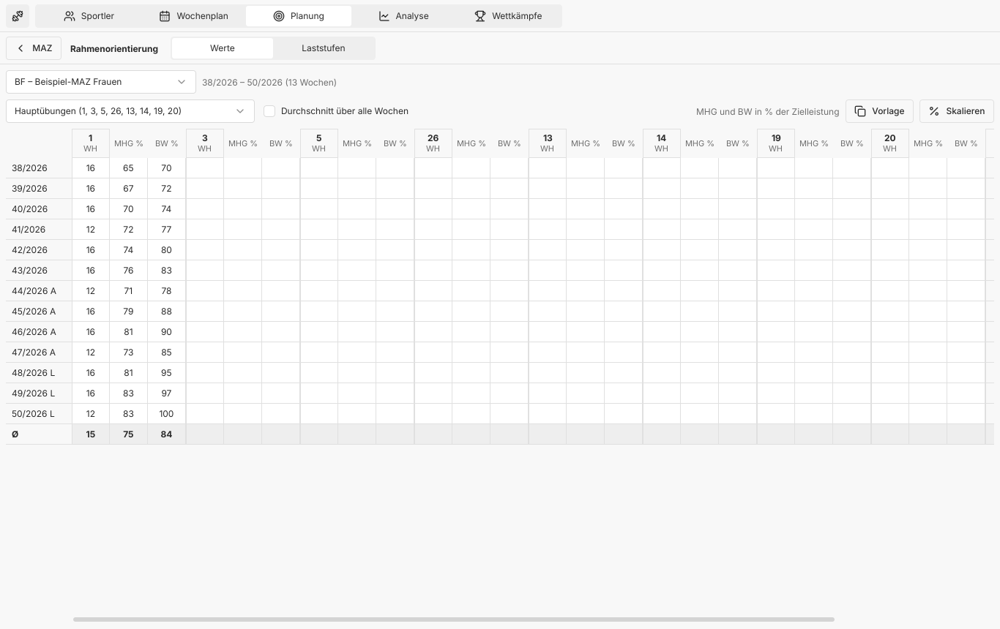

**Rahmenorientierung** beim MAZ öffnet den Rahmenplan: je Woche und Übung
WH, MHG % und BW %. Die Prozente beziehen sich auf die Zielleistung. Am
Ende steht der Durchschnitt (Ø). Zurück geht es mit **‹ MAZ**.

Die Auswahl **Komplexe K1–K7** zeigt die Wiederholungen je Komplex, wie
die Rahmentrainingskonzeption sie vorgibt. Daneben stehen in jeder
Ansicht **K1-7** und **K1-5**, die Summen der Komplexe; sie rechnet das
Programm, eintragen lassen sie sich nicht.

> **Beispiel:** Ein MAZ aus der Vorlage „RTK U17“ hat in der ersten
> Woche K1 70, K2 70, K3 90, K5 100, K6 50 und K7 10 WH, zusammen K1-7
> 390 und K1-5 330. Im Durchschnitt sind es 358 und 298, wie in der RTK.

> **Beispiel:** Woche 38/2026: Reißen 16 WH, MHG 65 %, BW 70 %. MHG und
> BW sind die der Rahmenorientierung U17 der Rahmentrainingskonzeption.
> Sie gibt die Wiederholungen nur je Komplex (K1 bis K7) vor; die 16 WH
> des Reißens sind für das Beispiel gewählt.

### ITP

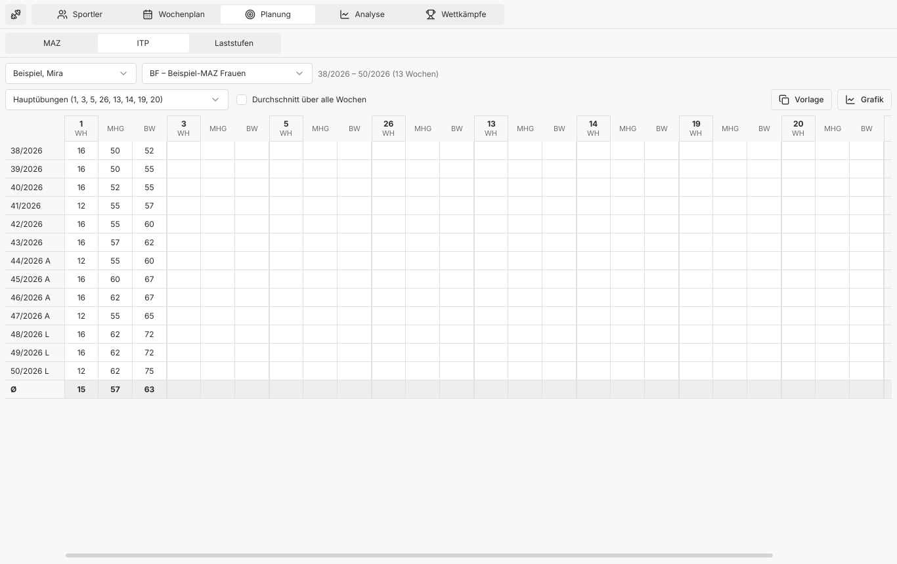

Das ITP ist der Plan eines Sportlers in kg. **Vorlage** berechnet es aus
der Rahmenorientierung und der Zielleistung des Sportlers, gerundet auf
den Gewichtsschritt (2,5 kg). Jede Zahl lässt sich danach von Hand ändern.
Weiter rechts stehen die Spalten **Bel.** (Belastung h/m/g), **WK**
(Wettkampflage: LG, WK oder HWK für den Hauptwettkampf) und **Tr.-Wo.**:
die Trainingswochen bis zum Hauptwettkampf wie in der
Rahmentrainingskonzeption, 1 in seiner Woche. Das Programm zählt sie
selbst; ein anderes HWK in der Spalte WK zählt sofort neu. Dieselben
Spalten hat die Rahmenorientierung.

> **Beispiel:** Woche 38/2026 für Mira: Reißen 16 WH, MHG 50 kg
> (65 % von 76), BW 52 kg (70 % von 76, auf 2,5 kg gerundet).

Statt alles auf einmal lässt sich die Rahmenorientierung auch Zelle für
Zelle übernehmen. Gehört der Sportler zum MAZ, zeigt jede leere Zelle
grau und schräg den **Vorschlag der RO**: den Wert, den **Vorlage**
eintragen würde. **Strg+Eingabe** in der Zelle übernimmt ihn, bei der
BW mit Wiederholungen und Sätzen. Ein Rechtsklick auf eine Zelle bietet
**Vorschlag der RO übernehmen** und **Woche … aus der RO übernehmen**,
ein Rechtsklick auf die Woche links nur das Zweite. Die ganze Woche
übernimmt alle Spalten, die das Raster zeigt, auch Bel. und WK; Zellen,
für die die RO nichts vorsieht, bleiben, wie sie sind.

> **Beispiel:** Zielleistung im Reißen 80 kg, RTK U17, Woche 2: Die
> leere MHG-Zelle zeigt grau 52 (67 % von 80, auf 2,5 kg gerundet), die
> BW 57. Eine selbst eingetragene BW 50 bleibt stehen, bis man den
> Vorschlag oder die ganze Woche übernimmt.

Die Liste oben links wählt, welche Übungen das Raster zeigt (z. B. die
Hauptübungen). *Durchschnitt über alle Wochen* ändert die Ø-Zeile.
**Grafik** öffnet den Belastungsverlauf.

**Skalieren** ändert Werte um einen Faktor, z. B. nach einer Krankheit
auf 90 %. Im Dialog stehen die Wochen (vorgewählt alle des Plans), die
Werte WH, MHG und BW und der Faktor in Prozent. Es ändern sich die
Übungen, die das Raster gerade zeigt. MHG und BW werden auf den
Gewichtsschritt gerundet, WH auf ganze Wiederholungen. K1-7 und K1-5
folgen den Komplexen, die Laststufen bleiben, wie sie sind. In der
Rahmenorientierung geht es ebenso, dort auf ganze Prozent gerundet.

> **Beispiel:** Mira war krank und soll leichter wieder einsteigen.
> Wochen 46/2026 bis 47/2026, nur MHG und BW, Faktor 90 %: Reißen BW
> 67 kg wird 60 kg (60,3 auf 2,5 kg gerundet), MHG 62 kg wird 55 kg.

### Grenzen des Trainingsmittelkatalogs

In Rahmenorientierung und ITP zeigt das Programm eine Zahl **rot**, wenn
sie nicht zum Trainingsmittelkatalog von BVDG und IAT (TMK 2018) passt.
Mit der Maus über der Zahl steht der Grund:

- Die **BW** liegt über dem Wert des TMK für die Altersstufe, z. B. im
  Reißen bei Schülern (AK 14–15) über 95 % der Zielleistung.
- Die Übung oder der Komplex ist für die Altersstufe noch nicht
  vorgesehen: K3 erst ab den Schülern, K6 ab der Jugend (AK 16–17), K4
  ab den Junioren (AK 18–20). Die Halbkniebeuge sieht der TMK für keine
  Altersstufe vor.

Die Altersstufe ergibt sich aus der Altersklasse in der jeweiligen
Woche. In der Rahmenorientierung zählen die Jüngsten des MAZ; ohne
Sportler im MAZ prüft das Programm nichts. Im ITP rechnet es den Wert
des TMK mit der Zielleistung in kg um und rundet wie **Vorlage**. In
einer Woche mit Wettkampf (WK-Lage **WK** oder **HWK**) dürfen Reißen
und Stoßen darüber liegen, denn der Wettkampf selbst geht bis 100 % und
mehr. Die rote Zahl ist ein Hinweis: sie bleibt, wie sie eingetragen ist.

Mit der Maus über den Spaltenköpfen **K1** bis **K6** und **K1-7** steht
außerdem der Richtwert des TMK für die Wiederholungen je Woche, z. B. für
die Jugend K1-7 350 und K3 80. Die Vorlagen der RTK treffen ihn im Mittel
(U17: 358 WH K1-7 je Woche).

> **Beispiel:** Die Vorlagen der RTK bleiben in allen Trainingswochen
> innerhalb des TMK. Setzt man in „RTK U17“ für eine Sportlerin der
> AK 16 die BW im Reißen der ersten Woche auf 98 %, wird die 98 rot:
> „Über dem TMK 2018 für Jugend (AK 16–17): BW bis 97 % des
> Wettkampfziels.“

### Laststufen

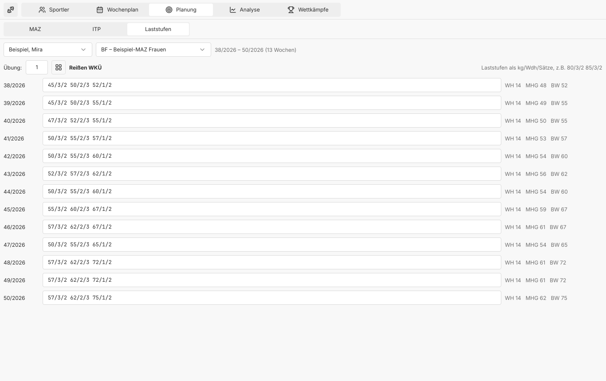

Je Woche die geplanten Laststufen einer Übung, geschrieben als
`kg/Wdh/Sätze`. Rechts rechnet das Programm daraus WH, MHG und BW.

> **Beispiel:** Woche 38/2026, Reißen: `45/3/2 50/2/3 52/1/2`, also
> 45 kg 3×2, 50 kg 2×3, 52 kg 1×2. Das ergibt 14 WH, MHG 48, BW 52.

---

## 7. Analyse

Oben die Art der Auswertung, rechts **Kopieren** (für eine
Tabellenkalkulation), **Drucken** und **Speichern unter** (PDF oder CSV).
Die Tabellen stehen sofort da und folgen jeder Änderung der Einstellungen
links.

### Individualanalyse

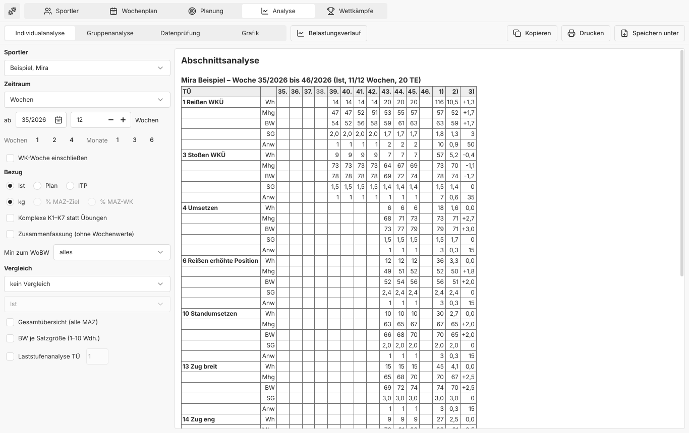

Die **Abschnittsanalyse** eines Sportlers: je Übung WH, Mhg, BW und SG
Woche für Woche, rechts Summe, Durchschnitt und Entwicklung. Die Zeile
**Anw** zählt, in wie vielen Trainingseinheiten die Übung vorkommt: je
Woche, zusammen, pro Woche und als Anteil an allen Einheiten (in %). Bei
den Komplexen K1–K7 zählt eine Einheit einmal, auch wenn mehrere Übungen
des Komplexes darin stehen. Als
Zeitraum lassen sich Wochen oder eine MAZ wählen; die Knöpfe **Wochen
1 2 4** und **Monate 1 3 6** stellen die letzten Wochen oder Monate bis
zur aktuellen Woche ein (auch in Datenprüfung und Grafik). Der gerade
eingestellte Zeitraum ist hervorgehoben. Als Bezug Ist, Plan
oder ITP, in kg oder in % des Ziels. Dazu wahlweise ein Vergleich mit
einem anderen Zeitraum.

> **Beispiel:** Mira, 12 Wochen ab 35/2026, Ist: Reißen WKÜ mit 14 WH in
> den Wochen 39–42 und 20 WH in den Wochen 43–45, zusammen 116 WH. Es
> kommt in 10 der 20 Einheiten vor (Anw 10, 0,9 pro Woche, 50 %).
> Woche 38 ist grau: Es ist die Woche eines Wettkampfs (15.09.), die nur
> mit *WK-Woche einschließen* mitzählt. Deshalb steht oben „11/12 Wochen“.

**BW je Satzgröße (1–10 Wdh.)** hängt eine Tabelle an: je Übung das
höchste Gewicht, das im Zeitraum in Sätzen zu 1, 2 … 10 Wiederholungen
bewältigt wurde, aus dem Ist oder dem Plan (das ITP hat keine Sätze).
Laststufen, deren Versuche alle ungültig waren, zählen nicht; die Woche
eines Wettkampfs nur mit *WK-Woche einschließen*.

> **Beispiel:** Mira, Beispiel-MAZ Frauen, Ist: Reißen WKÜ 63 kg im
> Einzelversuch, 58 kg im Zweiersatz, 52 kg im Dreiersatz; Kniebeuge vorn
> 102 kg zu 2, 93 kg zu 3 und 75 kg zu 5 Wiederholungen.

### Gruppenanalyse

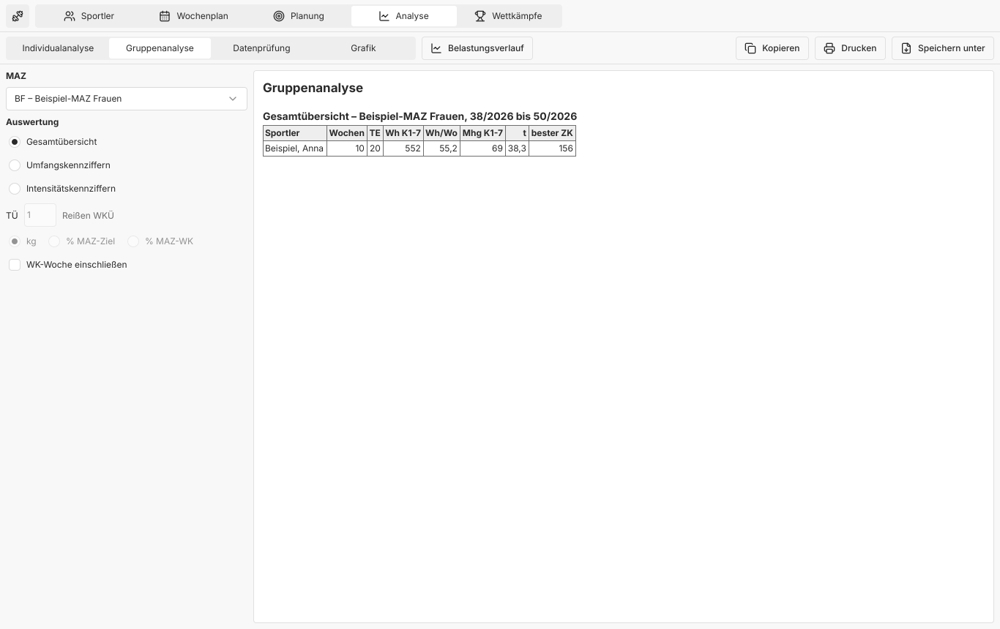

Alle Sportler eines MAZ nebeneinander: Gesamtübersicht, Umfangs- und
Intensitätskennziffern oder eine einzelne Übung.

### Datenprüfung

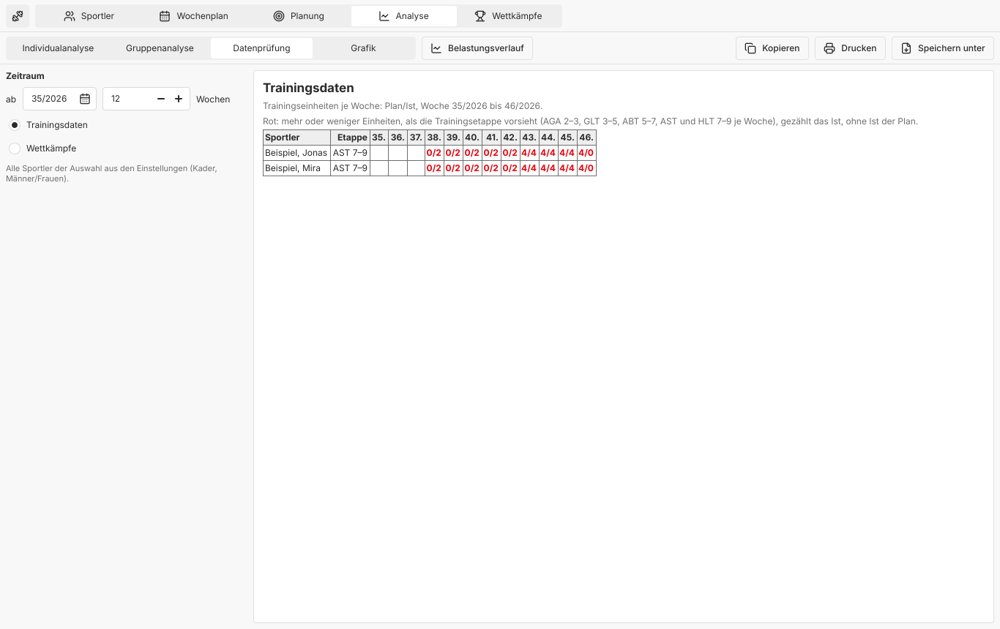

Welche Sportler wie viele Einheiten je Woche eingetragen haben (Plan/Ist),
oder welche Wettkämpfe. So fällt auf, wo das Ist fehlt.

Die Spalte **Etappe** nennt die Trainingsetappe mit ihren Einheiten je
Woche. **Rot** ist eine Woche mit mehr oder weniger Einheiten, als die
Etappe in dieser Woche vorsieht. Gezählt wird das Ist, in einer Woche
ohne Ist der Plan; leere Wochen bleiben ohne Markierung.

> **Beispiel:** Mira (AK 19, AST 7–9) trainiert in den Beispieldaten zwei
> bis vier Mal je Woche; alle ihre Wochen sind rot. Die Etappen
> beschreiben den Weg in den Leistungssport, im Verein darf es weniger
> sein.

### Grafik

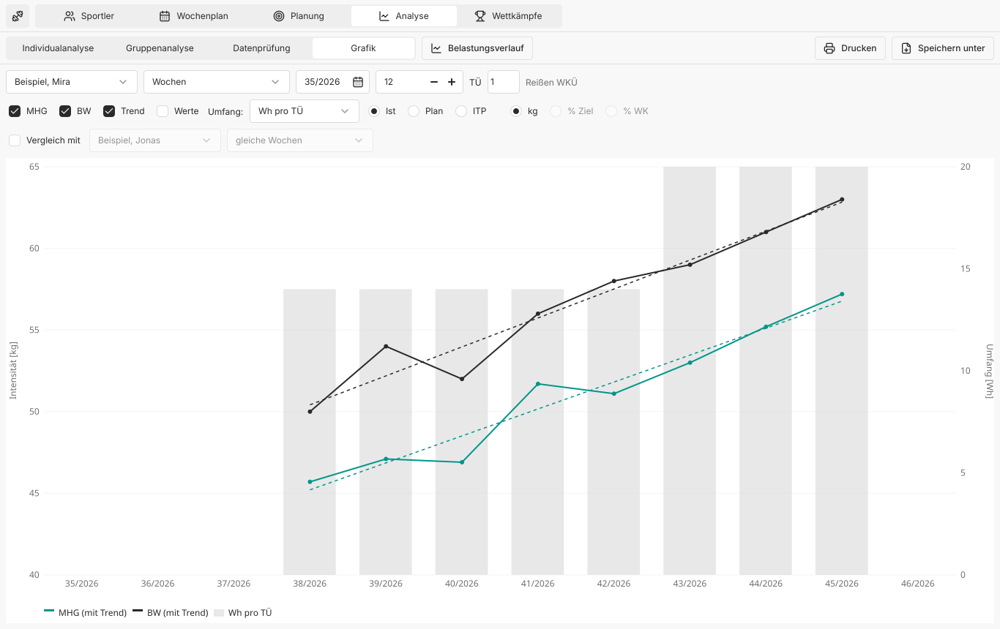

Eine Übung über die Wochen: MHG und BW als Linien (mit Trend), der
Umfang als Balken. Ein zweiter Sportler oder Zeitraum lässt sich zum
Vergleich dazunehmen. **Ist + Plan** zeigt beides in einer Grafik: das
Ist durchgezogen, den Plan gestrichelt in derselben Farbe, die
Wiederholungen des Plans als helle violette Balken.

> **Beispiel:** Mira, Reißen WKÜ, Wochen 35 bis 46/2026, Ist + Plan: In
> den Wochen 43 bis 45 liegen Ist und Plan aufeinander, in Woche 46 gibt
> es nur den Plan (BW 58 kg gestrichelt).

**Ø Gruppe** zeigt daneben den Durchschnitt einer Gruppe: eines Kaders
oder Vereins (nach der heutigen Zugehörigkeit der Sportler) oder der
Sportler eines MAZ. Der gewählte Sportler selbst zählt nicht mit; je
Woche mitteln nur die, die in der Woche Werte haben. Rechts steht, wie
viele Sportler eingehen. Bei **% Ziel** und **% WK** zählen nur Sportler
mit einer Zielleistung im gewählten MAZ, so lassen sich Sportler
verschiedener Gewichtsklassen vergleichen.

> **Beispiel:** Mira, Reißen WKÜ, Ø Gruppe „Verein Beispielverein“: Der
> Durchschnitt ist hier Jonas allein (1 Sportler), sein BW liegt 22 bis
> 29 kg über Miras.

---

## 8. Wettkämpfe

### Ergebnisse

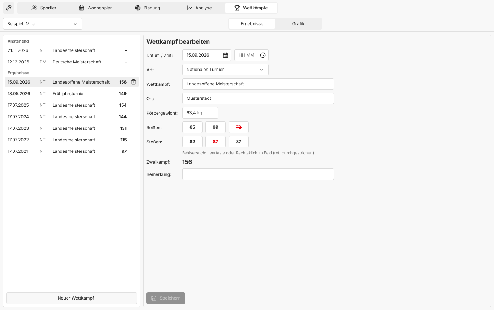

Links die Wettkämpfe des Sportlers mit Zweikampf, rechts der gewählte:
Datum, Art, Name, Ort, Körpergewicht und die drei Versuche im Reißen und
Stoßen. Einen **Fehlversuch** markieren Sie mit der Leertaste oder einem
Rechtsklick ins Feld: Er wird rot und durchgestrichen. Den Zweikampf
rechnet das Programm aus den besten gültigen Versuchen.

Die Beispieldaten haben je Sportler eine Landesmeisterschaft in jedem
der fünf Jahre davor, so hat die Entwicklungskurve genug Jahre.

> **Beispiel:** Landesoffene Meisterschaft am 15.09.2026, 63,4 kg:
> Reißen 65 / 69 / ~~72~~, Stoßen 82 / ~~87~~ / 87 (im dritten Versuch
> geschafft), Zweikampf 69 + 87 = **156**.

Kommende Termine (hier Landesmeisterschaft und Deutsche Meisterschaft)
stehen ohne Ergebnis in der Liste, bis sie eingetragen sind.

### Grafik

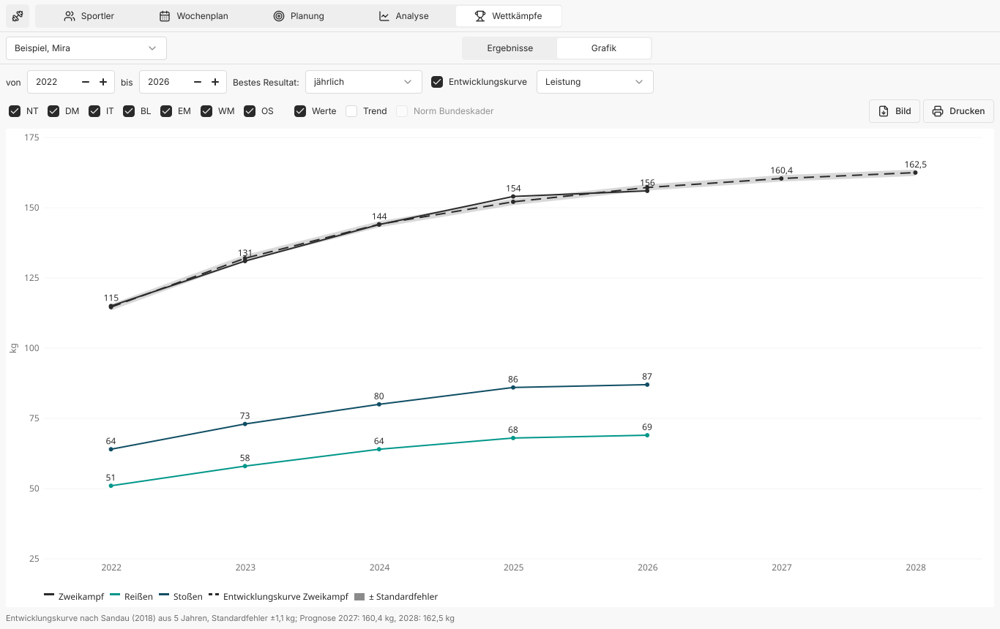

Die Entwicklung von Zweikampf, Reißen und Stoßen über die Jahre. Die Arten
von Wettkämpfen (NT, DM, …) lassen sich ein- und ausblenden. **Bestes
Resultat** zeigt jeden Wettkampf, das beste je Halbjahr oder je Jahr.

Mit **jährlich** lässt sich die **Entwicklungskurve** einblenden: eine
Gompertz-Kurve nach Sandau (2018) durch die Jahresbesten des Zweikampfs,
gestrichelt und zwei Jahre über das letzte Ergebnis hinaus, mit dem
Standardfehler als grauem Band. Unter der Grafik stehen die Zahl der
Jahre, der Standardfehler und die Prognose. Die Kurve braucht Ergebnisse
aus mindestens vier Jahren; einen Verlauf, der noch keine Sättigung
erkennen lässt, zeichnet sie nicht.

Statt **Leistung** zeigt **Körpergewicht** das Körpergewicht beim
jeweils besten Zweikampf, mit seiner eigenen Kurve und den
Gewichtsklassen ringsum als Linien: bis AK 17 die der Jugend, danach
die der Junioren und Aktiven.

> **Beispiel:** Mira, 2022 bis 2026, jährlich: Zweikampf 115, 131, 144,
> 154 und 156 kg. Die Kurve aus 5 Jahren hat einen Standardfehler von
> ±1,1 kg und sagt für 2027 160,4 kg und für 2028 162,5 kg voraus.

---

## 9. Einstellungen

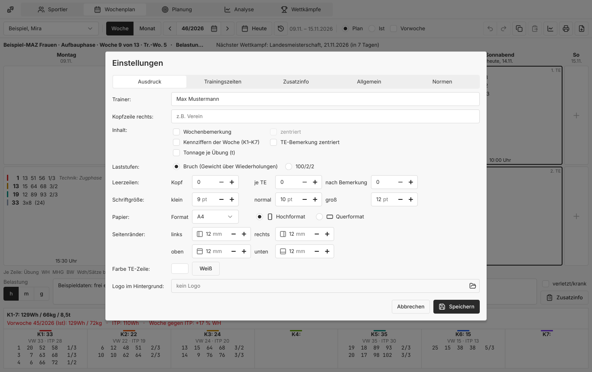

*Hantel-Menü › Einstellungen…*

- **Ausdruck**: Trainer und Kopfzeile, was auf den Wochenplan kommt
  (auch die Tonnage je Übung),
  Schriftgrößen, Papier und Ränder, Logo.
- **Trainingszeiten**: die üblichen Zeiten der 1., 2. und 3. TE und wie
  viele Einheiten pro Tag die Woche zeigt.
- **Zusatzinfo**: welche Werte es je Tag gibt.
- **Allgemein**: Gewichtsschritt (1 oder 2,5 kg), Farbschema (hell,
  dunkel, klassisch wie das alte Programm), die Projektdatei.
- **Normen**: die Normen der DM Nachwuchs, für AK 14, AK 15 und
  AK 16–17.

---

## 10. Tastenkürzel

| Taste | Wirkung |
|---|---|
| Strg+1 … Strg+5 | Sportler, Wochenplan, Planung, Analyse, Wettkämpfe |
| Strg+← / Strg+→ | Woche zurück / vor |
| Strg+Z / Strg+Y | rückgängig / wiederholen |
| Strg+S | Einheit oder Formular speichern |
| Strg+P | Drucken (mit Vorschau) |
| ↑ / ↓ in Gewichtsfeldern | nächstes Gewicht im Gewichtsschritt |
| ↑ / ↓ in Wdh/Sätze | zählen |
| Leertaste im Versuchsfeld | Fehlversuch |
| Strg+N / Strg+O / Strg+Umschalt+S | neues Projekt / öffnen / speichern unter |
| F1 | Hilfe |
| Strg+Q | Beenden |

---

## 11. Begriffe

| Begriff | Bedeutung |
|---|---|
| TÜ | Trainingsübung, mit den Nummern des alten Programms |
| TE | Trainingseinheit, bis zu drei am Tag |
| Plan / Ist | geplante / tatsächlich trainierte Woche |
| Laststufe | ein Gewicht mit Wiederholungen und Sätzen, z. B. 80 kg 3/2 |
| SG/ANZ | Wiederholungen je Satz / Anzahl der Sätze: 3/2 sind 2 Sätze zu je 3 |
| WH | Wiederholungen, Summe über alle Sätze |
| MHG | mittleres Hantelgewicht: Tonnage geteilt durch WH |
| BW | Bestwert: höchstes Gewicht der Übung in Woche bzw. Einheit |
| Tonnage | Gewicht × Wiederholungen, in Tonnen |
| K1–K7 | die sieben Übungsgruppen der Wochenauswertung; K1–5 fasst 1 bis 5 zusammen |
| MAZ | Makrozyklus, ein mehrwöchiger Trainingsabschnitt |
| RO | Rahmenorientierung, der Rahmenplan eines MAZ in Prozent |
| ITP | individueller Trainingsplan eines Sportlers, in kg |
| h / m / g | Belastung einer Woche: hoch, mittel, gesenkt |
| Zweikampf | bester gültiger Versuch im Reißen plus im Stoßen |
