# Handbuch Trainingsplaner Gewichtheben

Dieses Handbuch zeigt jede Ansicht des Programms an einem Beispiel. Alle
Bilder und Zahlen stammen aus den **Beispieldaten**, die das Programm selbst
mitbringt. Die Sportler „Beispiel, Mira“ und „Beispiel, Jonas“ sind frei
erfunden. Ihr Makrozyklus folgt dem Musterplan U17 der
Rahmentrainingskonzeption 2019 des BVDG, umgerechnet auf die Zielleistung
der Sportler.

Die Bilder entstanden am 14.11.2026 (Woche 46/2026). Die Beispieldaten
richten sich nach dem Tag, an dem man sie anlegt. Bei Ihnen stehen deshalb
andere Daten und Wochen, der Aufbau ist aber derselbe.

**Inhalt**

1. [Erste Schritte: Beispieldaten und Projekte](#1-erste-schritte-beispieldaten-und-projekte)
2. [Sportler](#2-sportler)
3. [Wochenplan](#3-wochenplan)
4. [Monat und Wettkampftermine](#4-monat-und-wettkampftermine)
5. [Belastungsverlauf](#5-belastungsverlauf)
6. [Planung: MAZ, Rahmenorientierung, ITP, Laststufen](#6-planung-maz-rahmenorientierung-itp-laststufen)
7. [Analyse](#7-analyse)
8. [Wettkämpfe](#8-wettkämpfe)
9. [Einstellungen](#9-einstellungen)
10. [Tastenkürzel](#10-tastenkürzel)
11. [Begriffe](#11-begriffe)

---

## 1. Erste Schritte: Beispieldaten und Projekte

### Willkommen

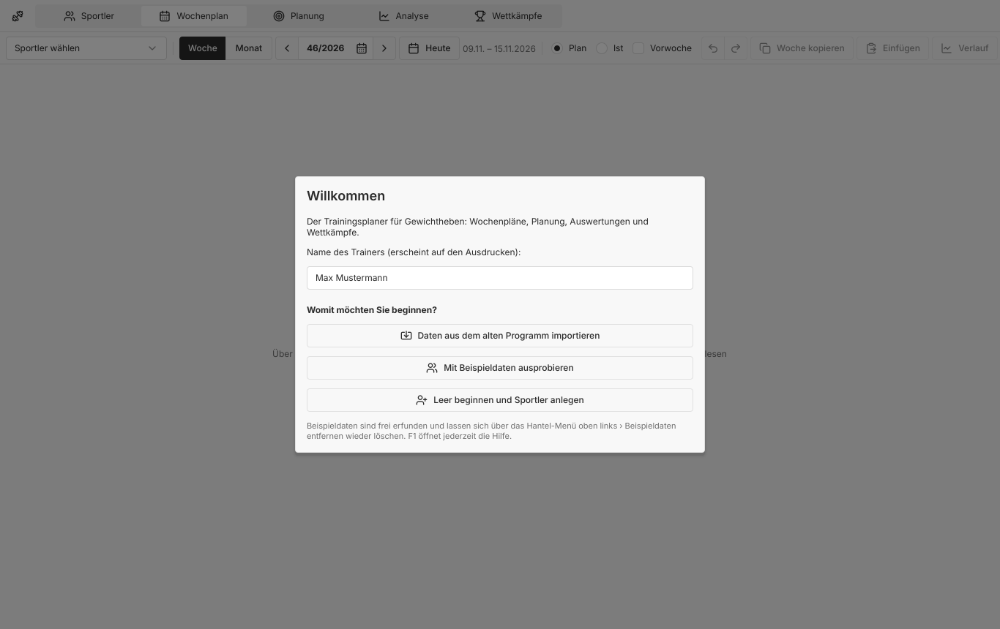

Beim ersten Start fragt das Programm nach dem Namen des Trainers (er steht
auf den Ausdrucken) und womit Sie beginnen möchten:

- **Daten aus dem alten Programm importieren**: liest die Datensicherung
  von WinWoTA XP (`winwotaxp.bak`) ein.
- **Mit Beispieldaten ausprobieren**: legt die beiden Beispiel-Sportler mit
  allem an, was dieses Handbuch zeigt.
- **Leer beginnen und Sportler anlegen**.

### Das Hantel-Menü

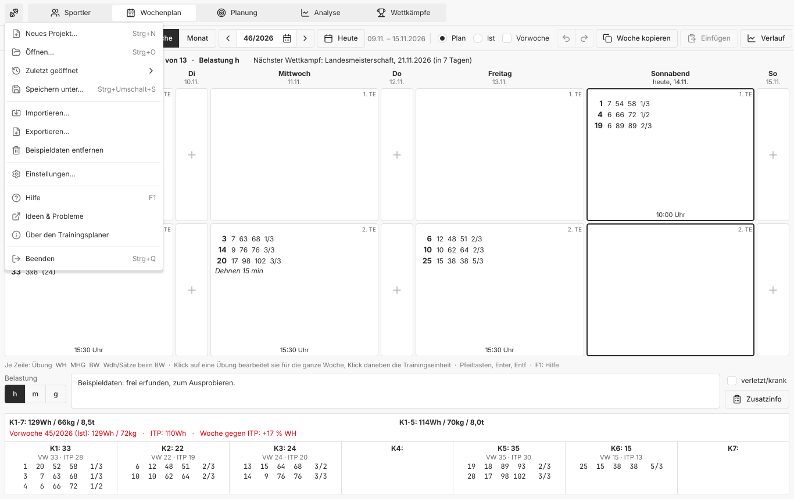

Die Hantel ganz links oben öffnet das Menü für alles, was keine eigene
Seite hat:

| Eintrag | Wozu |
|---|---|
| Neues Projekt… | eine neue, leere Projektdatei anlegen; danach erscheint wieder der Willkommen-Dialog |
| Öffnen… | eine andere Projektdatei öffnen |
| Zuletzt geöffnet | die letzten Projekte, zum schnellen Wechseln |
| Speichern unter… | eine Kopie des Projekts anlegen und darin weiterarbeiten (auch als Sicherung) |
| Importieren… / Exportieren… | Datensicherung im Format des alten Programms lesen oder schreiben |
| Beispieldaten entfernen | löscht die Beispiel-Sportler mit ihrem MAZ; Ihre eigenen Daten bleiben |
| Einstellungen… | siehe [Abschnitt 9](#9-einstellungen) |
| Hilfe, Über den Trainingsplaner | Kurzhilfe (auch F1), Version und Updates |
| Beenden | das Programm schließen |

**Projekte.** Ein Projekt ist eine Datei. Jede Änderung wird sofort darin
gespeichert, einen Knopf „Speichern“ braucht es deshalb nicht. Das Programm
öffnet beim Start das zuletzt benutzte Projekt.

> **Beispiel:** Um die Beispieldaten getrennt von Ihren echten Daten
> anzusehen, wählen Sie *Hantel-Menü › Neues Projekt…* und geben z. B.
> „Beispiel“ als Namen ein. Im Willkommen-Dialog klicken Sie dann *Mit
> Beispieldaten ausprobieren*. Über *Zuletzt geöffnet* kommen Sie jederzeit
> zu Ihren eigenen Daten zurück.

---

## 2. Sportler

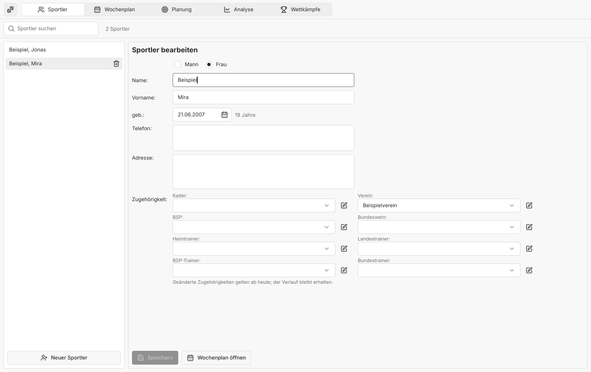

Links steht die Liste der Sportler mit einem Suchfeld darüber, rechts die
Angaben des gewählten Sportlers. **Neuer Sportler** legt einen an,
**Speichern** übernimmt Änderungen, **Wochenplan öffnen** springt zu seiner
Woche.

Unter *Zugehörigkeit* stehen Kader, Verein, Bundeswehr, Heimtrainer usw.
Diese Angaben gelten jeweils ab einem Datum: Das Stift-Symbol daneben zeigt
den Verlauf, z. B. seit wann jemand im Landeskader ist. Eine Änderung gilt
ab heute, der Verlauf davor bleibt erhalten.

> **Beispiel:** Mira Beispiel, geboren am 21.06.2007 (19 Jahre), Verein
> „Beispielverein“.

Der gewählte Sportler gilt für alle Seiten: Wer hier Mira wählt, sieht auch
im Wochenplan, in der Planung und in den Wettkämpfen Mira.

---

## 3. Wochenplan

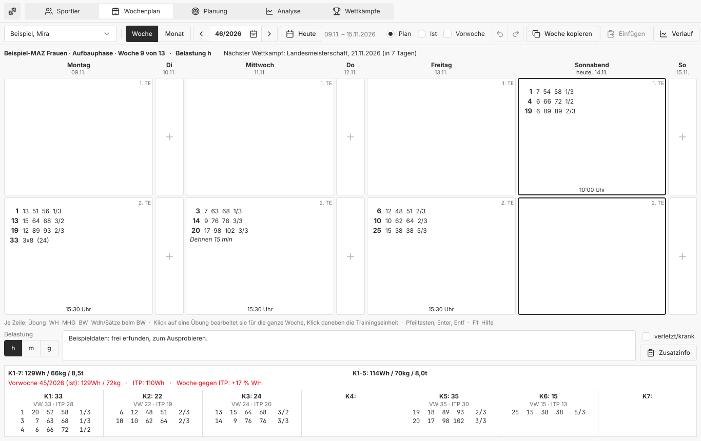

Die wichtigste Seite. Sie zeigt eine Woche eines Sportlers: oben die
Steuerung, in der Mitte die Trainingseinheiten der Tage, unten Belastung,
Bemerkung und die Auswertung der Woche.

### Die Leiste oben

- **Sportler** wählen.
- **Woche / Monat** umschalten (Monat: [Abschnitt 4](#4-monat-und-wettkampftermine)).
- **‹ 46/2026 ›** blättert eine Woche zurück oder vor (auch Strg+← / Strg+→),
  das Kalender-Symbol wählt eine Woche, **Heute** springt zur aktuellen.
- **Plan / Ist**: die geplante oder die tatsächlich trainierte Woche.
- **Vorwoche** zeigt die Woche davor über der aktuellen.
- **Rückgängig / Wiederholen** (Strg+Z / Strg+Y).
- **Woche kopieren / Einfügen** überträgt eine ganze Woche, auch zu einem
  anderen Sportler.
- **Verlauf** öffnet den Belastungsverlauf ([Abschnitt 5](#5-belastungsverlauf)).

Darunter fasst eine Zeile die Woche zusammen:

> Beispiel-MAZ Frauen · Aufbauphase · Woche 9 von 13 · Belastung h ·
> Nächster Wettkampf: Landesmeisterschaft, 21.11.2026 (in 7 Tagen)

### Eine Zeile lesen

In jeder Trainingseinheit (TE) steht je Übung eine Zeile:
**Übung, WH, MHG, BW, Wdh/Sätze beim BW**.

> **Beispiel:** Sonnabend, 1. TE: `1  7  54  58  1/3` heißt
> Übung 1 (Reißen WKÜ), 7 Wiederholungen, mittleres Hantelgewicht 54 kg,
> Bestwert 58 kg, beim Bestwert 1 Wiederholung in 3 Sätzen.

Text-Übungen wie `33 3x8 (24)` (Klimmzüge, 3×8, zusammen 24 WH) und freie
Notizen wie „Dehnen 15 min“ stehen ebenso in der Einheit.

### Eine Trainingseinheit bearbeiten

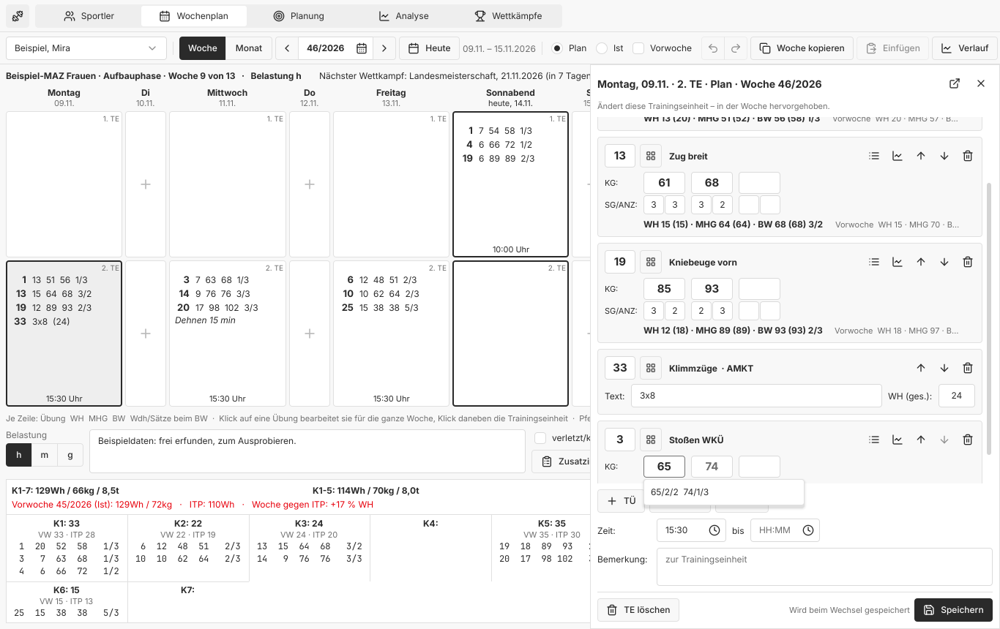

Ein Klick in eine Einheit öffnet sie rechts neben der Woche. Je Übung
stehen dort die Laststufen: oben das Gewicht (KG), darunter
Wiederholungen/Sätze (SG/ANZ).

> **Beispiel:** In Montag, 2. TE wurde mit *+ TÜ* die Übung 3 (Stoßen WKÜ)
> angefügt und 65 kg eingetippt. Das Programm schlägt die folgenden
> Laststufen grau vor; Pfeiltasten (↑/↓) zählen Wiederholungen und Sätze
> hoch und runter, Enter geht weiter.

Unter jeder Übung steht, was sie in der Woche ergibt und was die Vorwoche
und das ITP dazu sagen. *Zeit* und *bis* legen die Uhrzeit fest. Die
Einheit wird beim Wechsel zu einer anderen Einheit oder beim Schließen
gespeichert (sofort mit Strg+S). Jede Änderung lässt sich rückgängig
machen. Das Pfeil-Symbol oben rechts holt die Einheit in ein eigenes
Fenster.

### Eine Übung über die ganze Woche (Erfassung TÜ)

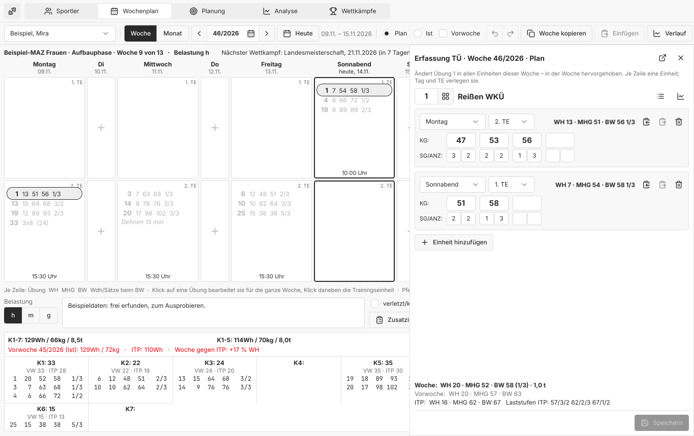

Ein Klick auf eine Übungszeile öffnet **Erfassung TÜ**: diese eine Übung in
allen Einheiten der Woche. In der Woche ist sie hervorgehoben.

> **Beispiel:** Reißen WKÜ steht am Montag (2. TE) und am Sonnabend (1. TE).
> Unten steht die Summe der Woche (WH 20 · MHG 52 · BW 58), daneben
> Vorwoche und ITP zum Vergleich. *Einheit hinzufügen* plant die Übung an
> einem weiteren Tag ein.

### Vorwoche

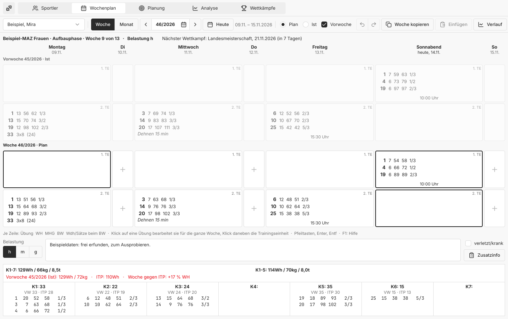

Mit **Vorwoche** steht die Woche davor über der aktuellen. Sie zeigt, was
in der letzten Woche wirklich trainiert wurde (Ist), während Sie die
aktuelle planen.

### Belastung, Bemerkung, verletzt/krank, Zusatzinfo

Unter der Woche:

- **Belastung h / m / g**: die Belastung der Woche (hoch, mittel, gesenkt).
  Es ist derselbe Wert wie im ITP unter „Bel.“, er lässt sich hier oder dort
  setzen. Ein Klick auf den gewählten Buchstaben nimmt ihn zurück.
  *Beispiel: Woche 46 ist „h“.*
- **Bemerkung zur Woche** und **verletzt/krank**.
- **Zusatzinfo**: Körpergewicht, Körperfett, Nahrungsergänzung und andere
  Werte je Tag.

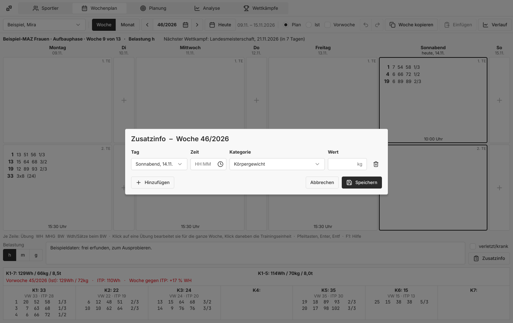

### Die Auswertung der Woche

Ganz unten wertet das Programm die Woche wie das alte Programm aus:

> **Beispiel (Woche 46, Plan):**
> `K1-7: 129Wh / 66kg / 8,5t`: alle Übungsgruppen zusammen 129
> Wiederholungen, im Mittel 66 kg, 8,5 Tonnen bewegt.
> Rot darunter der Vergleich: Vorwoche (Ist) 129 WH / 72 kg, ITP 110 WH,
> die Woche liegt also 17 % über dem ITP.
> Je Gruppe K1 … K7 die Übungen der Gruppe, mit Vorwoche (VW) und ITP:
> `K1: 33 · VW 33 · ITP 28`.

### Drucken

Strg+P (oder Drucken in der Monatsansicht) zeigt zuerst eine
Seitenvorschau wie im alten Programm. Dort lassen sich der Drucker und das
Papier wählen. Was auf dem Ausdruck steht, legen die
[Einstellungen › Ausdruck](#9-einstellungen) fest.

---

## 4. Monat und Wettkampftermine

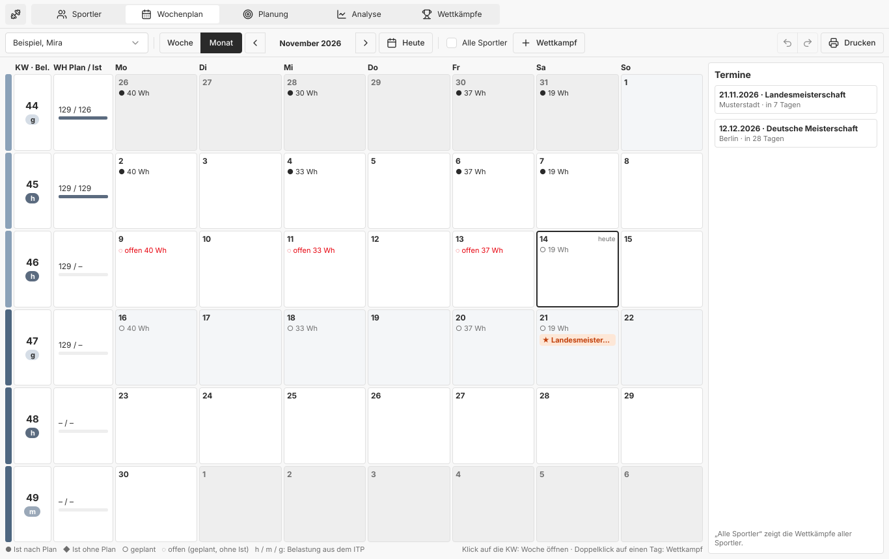

**Monat** zeigt vier bis sechs Wochen auf einmal:

- links je Woche die Kalenderwoche mit ihrer **Belastung** (h/m/g farbig)
  und den Wiederholungen **Plan / Ist** (`129 / 126`);
- in den Tagen die Einheiten: ● Ist nach Plan, ◆ Ist ohne Plan, ○ geplant,
  ◌ offen (geplant, aber ohne Ist, in Rot);
- rechts die **Termine**, also die kommenden Wettkämpfe.

Ein Klick auf eine Kalenderwoche öffnet diese Woche. **Alle Sportler**
zeigt die Wettkämpfe aller Sportler.

### Einen Wettkampf eintragen

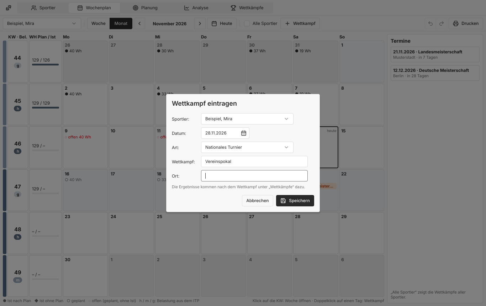

Ein Doppelklick auf einen Tag (oder **+ Wettkampf** oben) trägt einen
Wettkampftermin ein: Sportler, Datum, Art, Name und Ort. Beim Tippen des
Namens schlägt das Programm die Wettkämpfe der DGJ vor (DM Jugend,
Schülerpokal …). Für Sportler bis AK 17 warnt es, wenn in derselben Woche
schon ein Wettkampf steht. Für AK 16–17 nennt es die Norm der DM Jugend.

> **Beispiel:** Am 28.11.2026 „Vereinspokal“ als Nationales Turnier.
> Die Ergebnisse kommen nach dem Wettkampf unter „Wettkämpfe“ dazu.

---

## 5. Belastungsverlauf

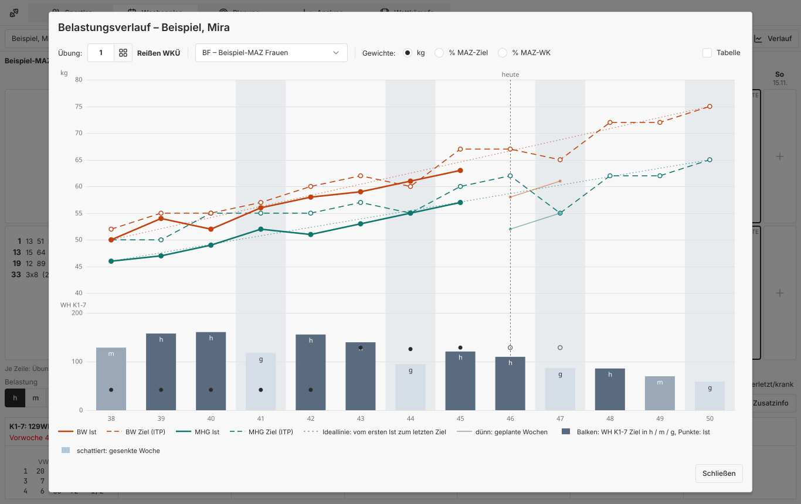

Der Belastungsverlauf zeigt, wie sich Gewicht und Umfang einer Übung über
die Wochen eines Makrozyklus entwickeln, und zwar gegen das, was das ITP
vorsieht. Sie finden ihn an drei Stellen:

- im **Wochenplan** über **Verlauf** (oben rechts);
- in der **Analyse** über **Belastungsverlauf**;
- in der **Planung** unter **ITP** über **Grafik**.

**So lesen Sie ihn**, am Beispiel Mira, Reißen WKÜ, Beispiel-MAZ Frauen
(Wochen 38 bis 50):

- **Oben die Gewichte:** durchgezogen das Ist, gestrichelt das Ziel aus dem
  ITP, rot der Bestwert (BW), grün das mittlere Hantelgewicht (MHG).
  Die gepunktete **Ideallinie** führt vom ersten Ist zum letzten Ziel. Dünne
  Linien rechts sind geplante Wochen.
- **Unten die Balken:** die Wiederholungen K1–K7 laut ITP, beschriftet mit
  der Belastung der Woche (h / m / g). Die Punkte darauf sind das Ist.
- **Grau schattiert** sind die gesenkten Wochen (g).
- Die senkrechte Linie **heute** trennt Vergangenheit und Zukunft.

> **Was man sieht:** Die gesenkten Wochen 41, 44, 47 und 50 geben die
> „Sägezahn“-Form: Die Ziel-Gewichte steigen in den hohen Wochen und fallen
> in den gesenkten zurück. Miras Ist (durchgezogen) folgt dem Ziel
> (gestrichelt) bis Woche 45 mit wenigen Kilo Abstand. Ab heute zeigen
> dünne Linien, was für die nächsten Wochen geplant ist.

Oben lassen sich **Übung** und **MAZ** wählen. **Gewichte** schaltet
zwischen kg, % des MAZ-Ziels und % des Wettkampfergebnisses um.
**Tabelle** zeigt dieselben Zahlen als Tabelle. Beim Darüberfahren
erscheinen die Werte.

---

## 6. Planung: MAZ, Rahmenorientierung, ITP, Laststufen

Die Planung folgt dem Weg der Rahmentrainingskonzeption: erst der
Makrozyklus (MAZ), dann sein Rahmenplan in Prozent (Rahmenorientierung,
RO), daraus der individuelle Trainingsplan (ITP) jedes Sportlers in kg.

### MAZ

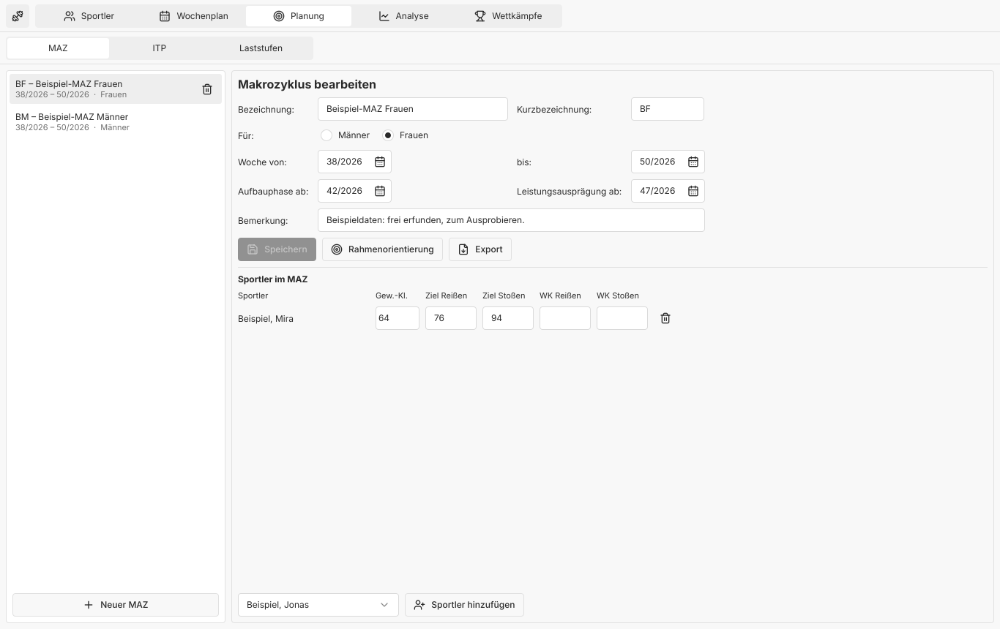

Links die Makrozyklen, rechts der gewählte: Name, Kurzbezeichnung, für
Männer oder Frauen, die Wochen von–bis, Beginn der **Aufbauphase** und der
**Leistungsausprägung**. Darunter die Sportler des MAZ mit Gewichtsklasse
und **Zielleistung** im Reißen und Stoßen.

> **Beispiel:** „Beispiel-MAZ Frauen“ (BF), Wochen 38/2026 bis 50/2026,
> Aufbauphase ab 42, Leistungsausprägung ab 47. Mira: Gewichtsklasse 64,
> Ziel Reißen 76 kg, Stoßen 94 kg.

### Rahmenorientierung

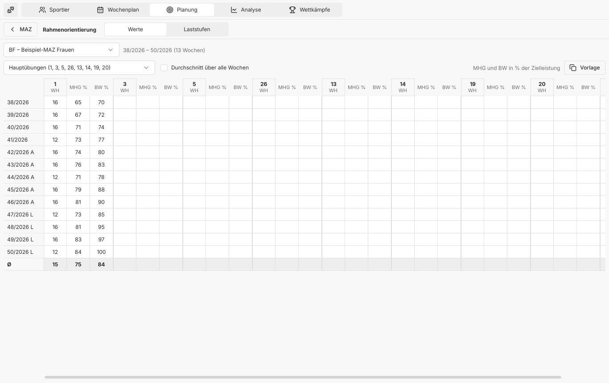

**Rahmenorientierung** beim MAZ öffnet den Rahmenplan: je Woche und Übung
WH, MHG % und BW %. Die Prozente beziehen sich auf die Zielleistung. Am
Ende steht der Durchschnitt (Ø). Zurück geht es mit **‹ MAZ**.

> **Beispiel:** Woche 38/2026: Reißen 16 WH, MHG 65 %, BW 70 %. Das sind
> die Werte des Musterplans U17, dessen Bezugssportler 100 kg reißt.

### ITP

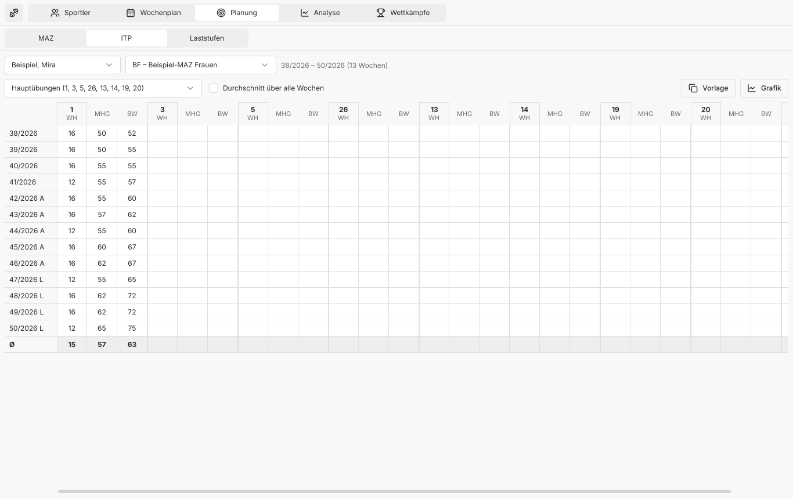

Das ITP ist der Plan eines Sportlers in kg. **Vorlage** berechnet es aus
der Rahmenorientierung und der Zielleistung des Sportlers, gerundet auf
den Gewichtsschritt (2,5 kg). Jede Zahl lässt sich danach von Hand ändern.
Weiter rechts stehen die Spalten **Bel.** (Belastung h/m/g) und **WK**
(Wettkampflage).

> **Beispiel:** Woche 38/2026 für Mira: Reißen 16 WH, MHG 50 kg
> (65 % von 76), BW 52 kg (70 % von 76, auf 2,5 kg gerundet).

Die Liste oben links wählt, welche Übungen das Raster zeigt (z. B. die
Hauptübungen). *Durchschnitt über alle Wochen* ändert die Ø-Zeile.
**Grafik** öffnet den Belastungsverlauf.

### Laststufen

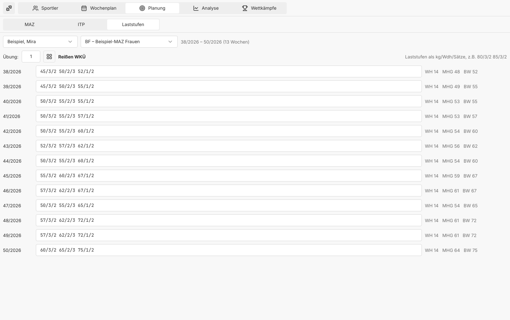

Je Woche die geplanten Laststufen einer Übung, geschrieben als
`kg/Wdh/Sätze`. Rechts rechnet das Programm daraus WH, MHG und BW.

> **Beispiel:** Woche 38/2026, Reißen: `45/3/2 50/2/3 52/1/2`, also
> 45 kg 3×2, 50 kg 2×3, 52 kg 1×2. Das ergibt 14 WH, MHG 48, BW 52.

---

## 7. Analyse

Oben die Art der Auswertung, rechts **Kopieren** (für eine
Tabellenkalkulation), **Drucken** und **Speichern unter** (PDF oder CSV).
Die Tabellen stehen sofort da und folgen jeder Änderung der Einstellungen
links.

### Individualanalyse

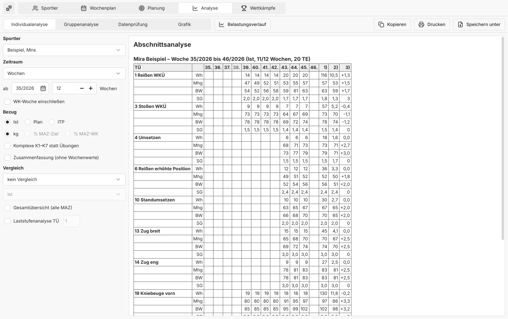

Die **Abschnittsanalyse** eines Sportlers: je Übung WH, Mhg, BW und SG
Woche für Woche, rechts Summe, Durchschnitt und Entwicklung. Als
Zeitraum lassen sich Wochen oder eine MAZ wählen. Als Bezug Ist, Plan
oder ITP, in kg oder in % des Ziels. Dazu wahlweise ein Vergleich mit
einem anderen Zeitraum.

> **Beispiel:** Mira, 12 Wochen ab 35/2026, Ist: Reißen WKÜ mit 14 WH in
> den Wochen 39–42 und 20 WH in den Wochen 43–45, zusammen 116 WH.
> Woche 38 ist grau: Es ist die Woche eines Wettkampfs (15.09.), die nur
> mit *WK-Woche einschließen* mitzählt. Deshalb steht oben „11/12 Wochen“.

### Gruppenanalyse

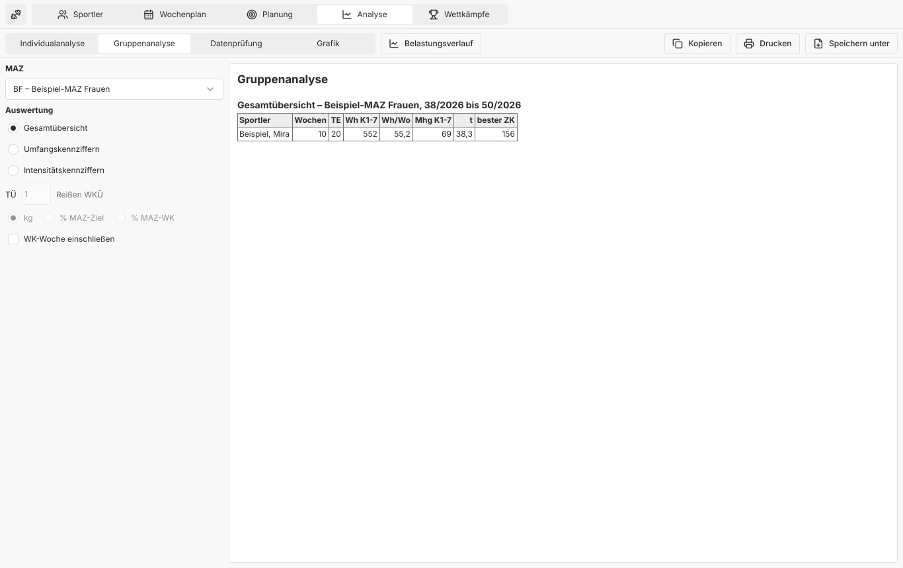

Alle Sportler eines MAZ nebeneinander: Gesamtübersicht, Umfangs- und
Intensitätskennziffern oder eine einzelne Übung.

### Datenprüfung

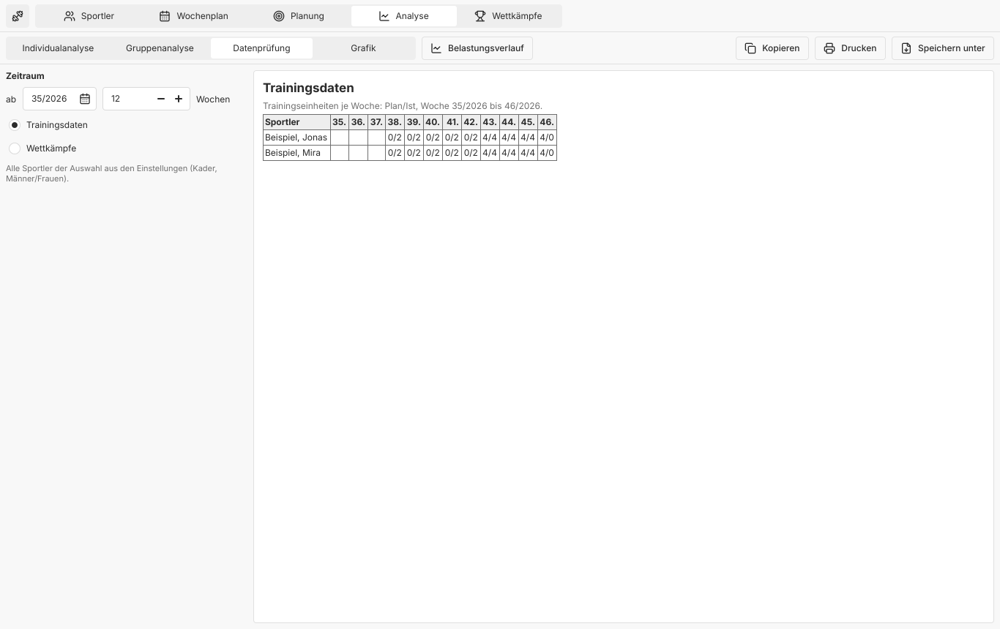

Welche Sportler wie viele Einheiten je Woche eingetragen haben (Plan/Ist),
oder welche Wettkämpfe. So fällt auf, wo das Ist fehlt.

### Grafik

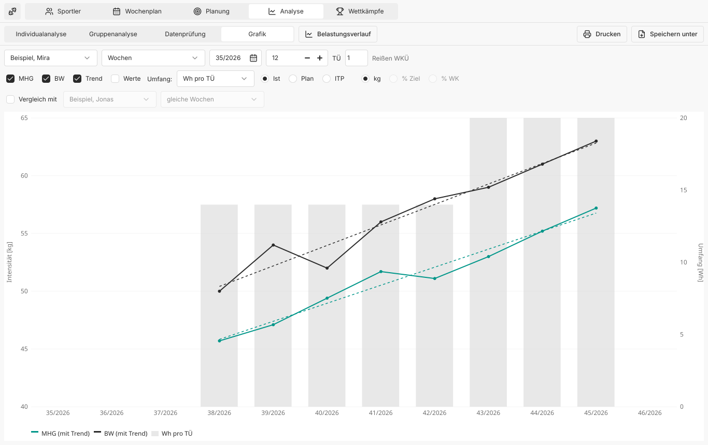

Eine Übung über die Wochen: MHG und BW als Linien (mit Trend), der
Umfang als Balken. Ein zweiter Sportler oder Zeitraum lässt sich zum
Vergleich dazunehmen.

---

## 8. Wettkämpfe

### Ergebnisse

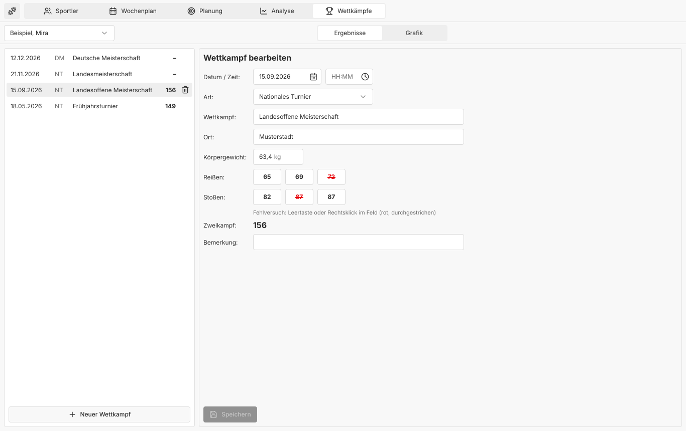

Links die Wettkämpfe des Sportlers mit Zweikampf, rechts der gewählte:
Datum, Art, Name, Ort, Körpergewicht und die drei Versuche im Reißen und
Stoßen. Einen **Fehlversuch** markieren Sie mit der Leertaste oder einem
Rechtsklick ins Feld: Er wird rot und durchgestrichen. Den Zweikampf
rechnet das Programm aus den besten gültigen Versuchen.

> **Beispiel:** Landesoffene Meisterschaft am 15.09.2026, 63,4 kg:
> Reißen 65 / 69 / ~~72~~, Stoßen 82 / ~~87~~ / 87 (im dritten Versuch
> geschafft), Zweikampf 69 + 87 = **156**.

Kommende Termine (hier Landesmeisterschaft und Deutsche Meisterschaft)
stehen ohne Ergebnis in der Liste, bis sie eingetragen sind.

### Grafik

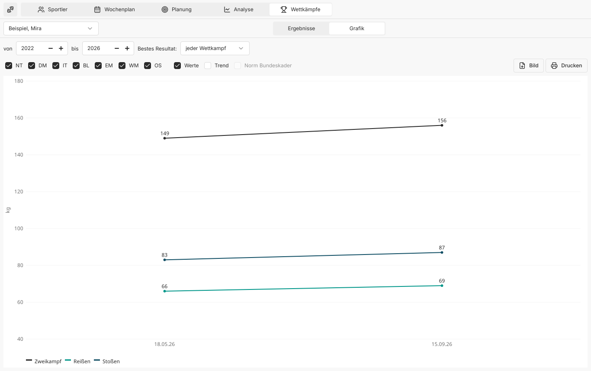

Die Entwicklung von Zweikampf, Reißen und Stoßen über die Jahre. Die Arten
von Wettkämpfen (NT, DM, …) lassen sich ein- und ausblenden.

> **Beispiel:** Mira von 149 (Mai) auf 156 (September).

---

## 9. Einstellungen

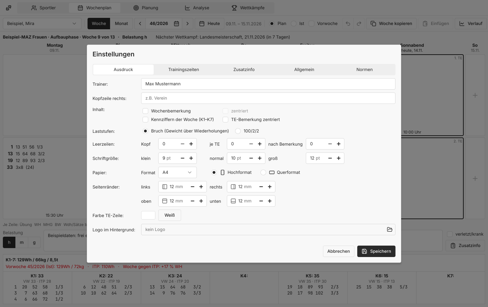

*Hantel-Menü › Einstellungen…*

- **Ausdruck**: Trainer und Kopfzeile, was auf den Wochenplan kommt,
  Schriftgrößen, Papier und Ränder, Logo.
- **Trainingszeiten**: die üblichen Zeiten der 1., 2. und 3. TE und wie
  viele Einheiten pro Tag die Woche zeigt.
- **Zusatzinfo**: welche Werte es je Tag gibt.
- **Allgemein**: Gewichtsschritt (1 oder 2,5 kg), Farbschema (hell,
  dunkel, klassisch wie das alte Programm), die Projektdatei.
- **Normen**: die Normen der DM Jugend.

---

## 10. Tastenkürzel

| Taste | Wirkung |
|---|---|
| Strg+1 … Strg+5 | Sportler, Wochenplan, Planung, Analyse, Wettkämpfe |
| Strg+← / Strg+→ | Woche zurück / vor |
| Strg+Z / Strg+Y | rückgängig / wiederholen |
| Strg+S | Einheit oder Formular speichern |
| Strg+P | Drucken (mit Vorschau) |
| ↑ / ↓ in Gewichtsfeldern | nächstes Gewicht im Gewichtsschritt |
| ↑ / ↓ in Wdh/Sätze | zählen |
| Leertaste im Versuchsfeld | Fehlversuch |
| Strg+N / Strg+O / Strg+Umschalt+S | neues Projekt / öffnen / speichern unter |
| F1 | Hilfe |
| Strg+Q | Beenden |

---

## 11. Begriffe

| Begriff | Bedeutung |
|---|---|
| TÜ | Trainingsübung, mit den Nummern des alten Programms |
| TE | Trainingseinheit, bis zu drei am Tag |
| Plan / Ist | geplante / tatsächlich trainierte Woche |
| Laststufe | ein Gewicht mit Wiederholungen und Sätzen, z. B. 80 kg 3/2 |
| SG/ANZ | Wiederholungen je Satz / Anzahl der Sätze: 3/2 sind 2 Sätze zu je 3 |
| WH | Wiederholungen, Summe über alle Sätze |
| MHG | mittleres Hantelgewicht: Tonnage geteilt durch WH |
| BW | Bestwert: höchstes Gewicht der Übung in Woche bzw. Einheit |
| Tonnage | Gewicht × Wiederholungen, in Tonnen |
| K1–K7 | die sieben Übungsgruppen der Wochenauswertung; K1–5 fasst 1 bis 5 zusammen |
| MAZ | Makrozyklus, ein mehrwöchiger Trainingsabschnitt |
| RO | Rahmenorientierung, der Rahmenplan eines MAZ in Prozent |
| ITP | individueller Trainingsplan eines Sportlers, in kg |
| h / m / g | Belastung einer Woche: hoch, mittel, gesenkt |
| Zweikampf | bester gültiger Versuch im Reißen plus im Stoßen |
