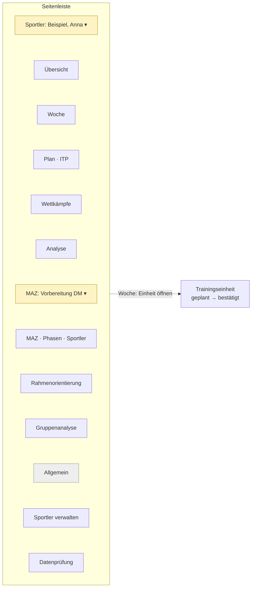
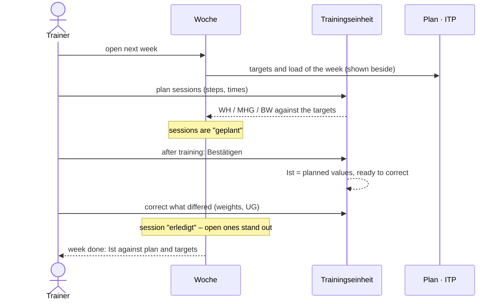
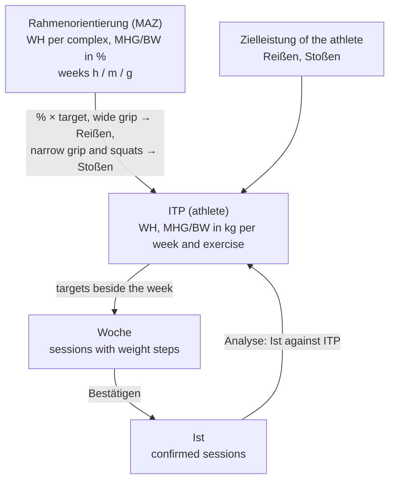
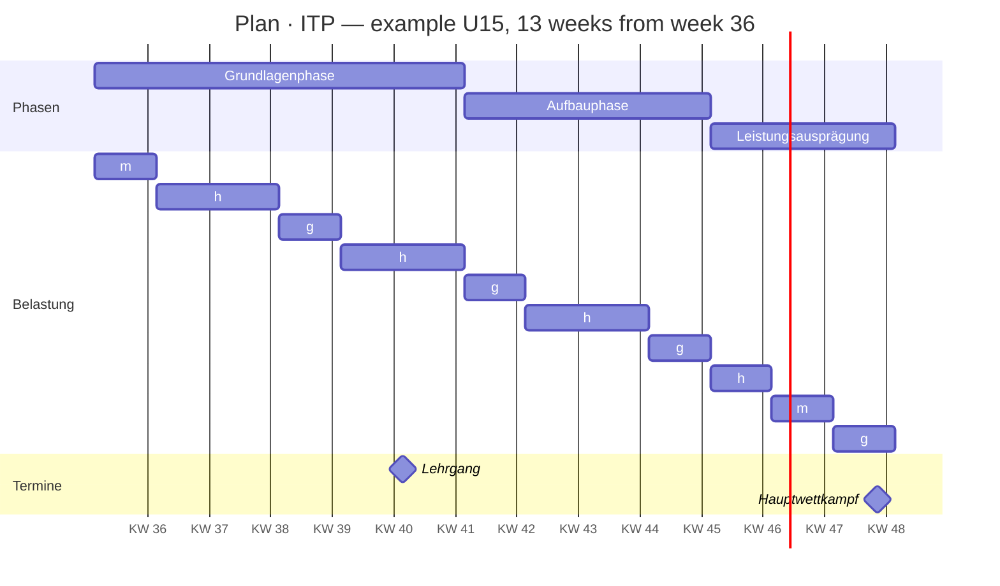
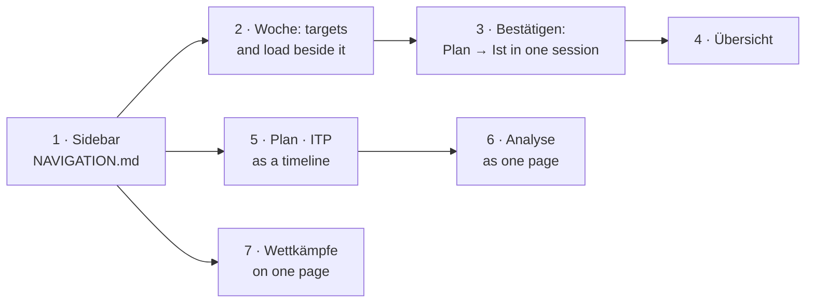

# UI/UX plan

How the Trainingsplaner should be organised around what a coach does,
drawn from three sources:

- **WinWoTA XP 2.61**, the old program: its 44 windows, drawn from the
  window definitions in `winwotaxp.exe` (layout data, not program code),
  and screenshots of it at work. The images are kept outside the
  repository (`../winwota-fenster/`, one per window and tab page), as
  they show another program's interface.
- **IDA**, the IAT's web successor of WinWoTA: its manual of May 2026
  (academy.german-weightlifting.de, IDA_Manual_Stand18.05.2026.pdf).
- **The BVDG's Rahmentrainingskonzeption 2019**, which sets how training
  is planned: framework plan → individual plan (ITP / MAZ plan) → week plan.

It builds on [NAVIGATION.md](NAVIGATION.md) (one sidebar instead of two
tab bars) and goes further: what each screen is for, how one gets from
the plan to the training done, and in which order to build it.

## 1. What a coach does, and how often

| Job | How often | Today in the Trainingsplaner |
|---|---|---|
| Plan next week's sessions | weekly | Wochenplan, Plan |
| Record what was done | after every session | Wochenplan, Ist (a separate week) |
| See whether the week matches the plan | weekly | not shown |
| Plan a cycle: MAZ, framework plan, ITP | 2–4 times a year | Planung › MAZ, ITP / RO, Laststufen |
| Look at the development | monthly, after a cycle | Analyse (4 tabs), Wettkämpfe › Grafik |
| Enter competitions | after each | Wettkämpfe |
| Keep athletes' data | rarely | Sportler |
| Exchange data, settings | rarely | Daten, Einstellungen |

The two most frequent jobs, planning a week and recording it, decide how
the program feels. Everything else is occasional.

## 2. The same jobs in WinWoTA, IDA and here

| Job | WinWoTA XP | IDA | Trainingsplaner now |
|---|---|---|---|
| Start | launcher: toolbar of 10 big buttons over an HTML page | start page with three tiles: Jahr, ITP, Woche | opens on the week of the last athlete |
| Athletes | Erfassung Sportlerdaten (form above, list below) | Nutzerverwaltung › Sportler | Sportler page, histories in dialogs |
| Cycle (MAZ) | Erfassung MAZ, "Sportler hinzufügen" opens a second window | levels of the ITP's time plan | Planung › MAZ |
| Framework plan (RO) | ITP-Planung in RO mode | columns "RO …" in % in the ITP's table | Planung › ITP / RO, switch RO |
| ITP | ITP-Planung: grid weeks × exercises, Vorlage window | time bar of levels (MAZ, meso, micro, weeks h/m/g) and a table of values, RO values taken over with "fx" | Planung › ITP / RO, switch ITP |
| Planned weight steps | ITP Laststufen (own window) | per session in the week | Planung › Laststufen |
| Week | Wochenplan: 7 × 2–3 cells, Plan/Ist switch | calendar with sessions as events, Soll/Ist/both | Wochenplan, Plan/Ist switch |
| Session | Erfassung Trainingseinheit | event dialog: time, athletes, contents, steps, totals | session dialog |
| Planned → done | enter Ist separately | **confirm** a planned session; it becomes Ist, values ready to correct | enter Ist separately, or "Ist = Plan" from the menu |
| Analyses | one window each, then "Tabelle", result in an HTML window | Daten › Abschnittsanalyse, Analyse (chart), Excel | Analyse with 4 tabs |
| Competitions | Erfassung Wettkämpfe, chart under Grafik | events in the calendar | Wettkämpfe with 2 tabs |

What IDA does differently, and better:

1. **One time axis.** The cycle, its phases, the weeks with their load
   (h / m / g) and the events are one plan on one timeline; the year, the
   ITP and the week are zoom levels of it.
2. **Planned and done are one record.** A planned session is confirmed;
   only then is it Ist, with the planned values to correct. Unconfirmed
   sessions are visible as open.
3. **A session has a time and people.** Several athletes can share a
   session; a competition or a training camp is an event in the same
   calendar.

What WinWoTA did that trainers know and IDA keeps: the week as seven
days with their sessions, the K1–K7 summary under it, and the printed
week plan.

## 3. What is strange in the Trainingsplaner now

1. **Two tab bars that look alike** (main areas, then sub-tabs), and an
   athlete box on every page although the athlete is one choice.
2. **Planung mixes three things**: the MAZ (a group), the ITP (one
   athlete) and the framework plan (the MAZ again), switched by a radio
   button that changes what the grid means; planned weight steps are a
   third tab, away from the week they belong to.
3. **Plan and Ist are two weeks.** Recording what was done means
   switching the week to Ist and entering it again, or copying it with
   a context menu ("Ist = Plan") session by session. Nothing shows which
   planned sessions are still open.
4. **The week does not show the plan above it**: the ITP's targets
   (WH, MHG, BW) and the week's load (h / m / g) are not beside the
   week's figures, so deviations go unnoticed.
5. **Two ways into the same data by where one clicks**: on an exercise
   line (Erfassung TÜ) or beside it (the session). Only a hint line
   tells.
6. **The analyses are four tools** with their own side panels and their
   own athlete box; charts are a fourth tab, and the competition chart
   lives on another page.
7. **No overview.** The program opens on a week, with nothing about
   what is due: open sessions, the next competition, the current phase.

## 4. Principles

- **The athlete and the cycle are context, the screens are places**
  (NAVIGATION.md): two pickers in the sidebar, one per subject; a picker
  never changes the place, a place never changes the picker.
- **One record from plan to done**: a session is planned, then confirmed
  with what was really done; Plan and Ist are its two states, not two
  weeks.
- **Each level shows the one above**: the week shows its targets from
  the ITP, the ITP its percentages from the framework plan.
- **Things that belong to a time are on the timeline**: phases, load of
  the week, competitions, camps.
- **Keep what trainers know**: the week grid, K1–K7, the printouts, the
  numbers and their names.

## 5. The new structure



| Place | What it is for | Replaces |
|---|---|---|
| **Übersicht** (new) | the athlete's now: this week's sessions open / done, the current phase and load of the week, the next competition, last week against its targets | the start on the week page |
| **Woche** | plan and record the week: seven days, sessions with Plan and Ist in one, K1–K7, and beside them the week's targets and load | Wochenplan, Plan/Ist switch, Laststufen tab |
| **Plan · ITP** | the athlete's cycle on one timeline: phases, weeks with load h/m/g, competitions; under it the table of targets per week and exercise | Planung › ITP |
| **Wettkämpfe** | results and their chart on one page | Wettkämpfe › Ergebnisse, Grafik |
| **Analyse** | one page: section analysis, comparisons and charts as views of the same choice | Analyse › Individualanalyse, Grafik |
| **MAZ** | the cycle: dates, phases, athletes with targets | Planung › MAZ |
| **Rahmenorientierung** | the framework plan in % on the MAZ's timeline | Planung › ITP / RO, switch RO |
| **Gruppenanalyse**, **Datenprüfung**, **Sportler verwalten** | as now, without their own pickers | the same tabs |

## 6. The weekly loop: plan, train, confirm



What changes for the coach:

- **One session, two states.** A session is "geplant" until confirmed,
  then "erledigt" with its own values; the cell shows both or either
  (switch Plan / Ist / beides, as in IDA).
- **Bestätigen** copies the planned steps into Ist; only what differed
  is changed. "Ist = Plan" from the context menu becomes this button.
- **Open sessions** of past days are marked in the week and counted in
  the Übersicht.
- **Without a plan** a session is recorded directly as Ist, as now.

Data: today Plan and Ist are separate weeks (variant P / I), which is
also the old program's export format. The model stays; the screen pairs
the session of a day and number in both variants and shows them as one.

## 7. The cycle: from framework plan to week



The Plan · ITP page as one timeline (IDA's levels, WinWoTA's grid):



Under the timeline, the table as now (weeks × exercises with WH, MHG,
BW), with the load as h / m / g instead of a number, and each cell able
to show its framework percentage beside the kg.

## 8. Sketches

**Übersicht**

```
┌ Sportler: Beispiel, Anna ▾ ─────────────────────────────────────────┐
│ Diese Woche 46/2026 · Aufbauphase · Belastung h                     │
│ ┌ Mo ┐┌ Di ┐┌ Mi ┐┌ Do ┐┌ Fr ┐┌ Sa ┐┌ So ┐                          │
│ │ ✓  ││ ✓  ││ ○  ││    ││ ○  ││    ││    │   ✓ erledigt  ○ offen    │
│ └────┘└────┘└────┘└────┘└────┘└────┘└────┘                          │
│ Woche gegen ITP:  WH 214 / 240   MHG 71 / 72   BW 85 / 88           │
│ Nächster Wettkampf: Landesmeisterschaft, 28.11. (in 15 Tagen)       │
│ Letzte Woche: 4 von 4 Einheiten bestätigt · K1-7 251Wh / 70kg       │
└─────────────────────────────────────────────────────────────────────┘
```

**Woche**

```
┌ 46/2026 ◂ ▸  Heute   Anzeige: Plan | Ist | beides     Bel. h  ┐
│ Mo        Di        Mi        Do        Fr        Sa    So    │
│ 1. TE ○   1. TE ✓   …                                         │
│  1 20 52  1 18 50                                             │
│  …                                                            │
│ 2. TE …                                                       │
├───────────────────────────────────────────────────────────────┤
│ K1-7  Plan 240Wh/72kg  Ist 214Wh/71kg  ITP 240Wh/72kg         │
│ K1 … K7 per complex, deviation from the ITP marked            │
└───────────────────────────────────────────────────────────────┘
```

**Trainingseinheit** (plan, then confirm)

```
┌ Montag, 09.11. · 2. TE · 15:30–17:00 · geplant ──────────────┐
│ TÜ 1  Reißen WKÜ   70/3×2  80/2×2  85/1×2   WH 16 MHG 78 BW 85│
│ TÜ 19 Kniebeuge v. 100/5×2 110/3×2          WH 16 MHG 104     │
│ …                                                             │
│                     [Abbrechen]  [Speichern]  [Bestätigen ✓]  │
└───────────────────────────────────────────────────────────────┘
```

## 9. Order of work



| Step | What | Size | Depends on |
|---|---|---|---|
| 1 | Sidebar with the two pickers; pages lose their sub-tab bars and athlete boxes | large | – |
| 2 | Week shows the ITP's targets and the load (h / m / g) beside its figures, deviations marked; load stored as h / m / g | medium | – |
| 3 | Bestätigen: a planned session becomes Ist with its values; open sessions marked; display Plan / Ist / beides | medium | 2 helps |
| 4 | Übersicht page | medium | 3 |
| 5 | Plan · ITP: timeline of phases, load and events over the existing table; planned weight steps move into the week's sessions | large | 1 |
| 6 | Analyse: one page, the section analysis, comparisons and charts as views of one choice | medium | 1 |
| 7 | Wettkämpfe: results and chart on one page | small | 1 |

Steps 2 and 3 help most for the least work and need no sidebar; step 1
makes room for the rest.

## 10. Open questions

- Is a session ever shared by several athletes (a group session, as IDA
  allows)? Today a session belongs to one athlete.
- Do the coaches want the athlete to confirm sessions (IDA's mobile
  view), or is that the coach's job only?
- Should camps and diagnostics be events in the week, or is the
  timeline of the cycle enough?
- Does the old program's export format need a place for the load
  (h / m / g) and the session state, or do they stay in our database?
