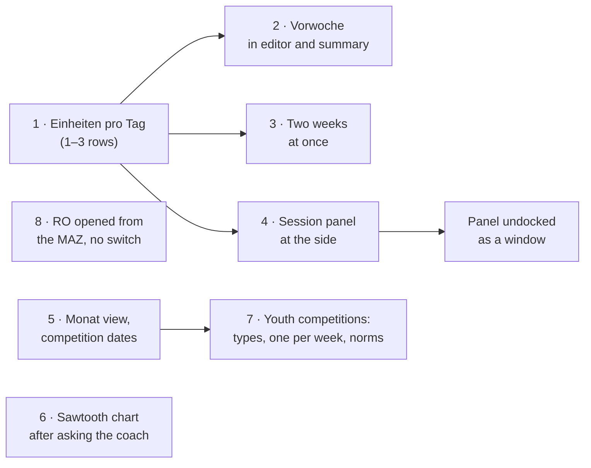

# UI/UX plan

How the Trainingsplaner should grow from here. The coach knows WinWoTA XP
well and is looking for a replacement because IDA, its web successor, made
everything more complex than he needs. So the direction is:

- **Stay close to WinWoTA.** The week grid, the Erfassung windows, the
  K1–K7 summary, the printouts and the names stay as he knows them.
- **Improve in small steps**, each one usable on its own, in the order
  of what the coach asks for.
- **IDA is a source of single ideas**, not the model.

Sources:

- **The coach's wishes** (November 2026), section 2.
- **WinWoTA XP 2.61**: its 44 windows, drawn from the window definitions
  in `winwotaxp.exe` (layout data, not program code). The images are
  kept outside the repository (`../winwota-fenster/`), as they show
  another program's interface.
- **IDA**: its manual of May 2026 (academy.german-weightlifting.de).
- **The BVDG's Rahmentrainingskonzeption 2019** (RTK): framework plan →
  ITP → week plan; its 75 sample weeks are in `tests/fixtures/`.
- **The DGJ's Jugendsportprogramm** (status 15 January 2020,
  german-weightlifting.de): the youth competitions, their dates, norms
  and scoring, section 4.

## 1. Where we are

| Job | How often | WinWoTA XP | Trainingsplaner now |
|---|---|---|---|
| Plan next week's sessions | weekly | Wochenplan, Plan | Wochenplan, Plan |
| Record what was done | after every session | Wochenplan, Ist | Wochenplan, Ist; "Ist = Plan" in the menu |
| Compare with last week | while planning | switch the week back and forth | the same |
| Keep the season's dates | weekly | not in the program (paper calendar) | not in the program |
| Plan a cycle: MAZ, RO, ITP | 2–4 times a year | Erfassung MAZ, ITP-Planung, ITP Laststufen | Planung › MAZ, ITP / RO, Laststufen |
| See the load over the weeks | weekly to monthly | ITP-Planung › Grafik, Grafik | Planung › ITP › Grafik, Analyse › Grafik |
| Enter competitions | after each | Erfassung Wettkämpfe | Wettkämpfe |
| Analyses | after a cycle | one window each | Analyse, 4 tabs |

The two most frequent jobs, planning a week and recording it, decide how
the program feels. That is where the coach's wishes are, too.

## 2. What the coach asked for

### 2.1 See the previous week while entering

When he enters a session's exercises (TÜ) he wants last week in view, to
judge the load he is giving. Today he has to switch weeks, and the
session dialog covers the week anyway.

Proposal, in two parts:

- **In the session editor**, every exercise line shows the same exercise
  of the previous week in grey: `Vorwoche: WH 18 · MHG 76 · BW 85`. The
  old Erfassung TE already showed a second set of figures per line,
  "TE (WO)", the session's values beside the week's; this adds last week
  to them.
- **Under the week grid**, the K1–K7 summary gets a column for the
  previous week and the difference: `K1-7  diese Woche 240 Wh / 72 kg ·
  Vorwoche 214 Wh / 71 kg · +12 %`.

Last week means its Ist where it has one, otherwise its Plan; the label
says which.

### 2.2 As many sessions per day as he uses, and two weeks at once

The grid always has two rows of sessions per day (three with "3 TE"),
as WinWoTA had. The coach trains one session a day. In the RTK's 75
sample weeks, too, 260 training days have one session and 37 have two.

Proposal:

- **A setting "Einheiten pro Tag": 1, 2 or 3** (default 2, as in
  WinWoTA). The grid shows that many rows, and more where a week has a
  session in a higher row, so no data is ever hidden. A day gets a
  further session from its context menu ("Weitere Einheit"). The
  "3 TE" checkbox goes.
- **"Vorwoche anzeigen"** in the toolbar, in the place of "3 TE": with
  one row per day there is room for two weeks, so the previous week
  stands above the current one. It is dimmed and labelled
  (`Vorwoche 45/2026 · Ist`); clicking into it switches to that week.
  This answers 2.1 a second time, for the whole week at a glance.

- **Days share the width by their content.** A day without sessions
  shrinks to a narrow column (its name, date and room to click into);
  the days with sessions share the rest. When even the narrow columns do
  not fit, for two weeks on a small screen, the grid scrolls sideways
  instead of squeezing the text.

The data does not change: sessions keep their numbers 1–3 as in the old
export format. To check with his data (counts only): whether his single
sessions are stored as 1. or 2. TE. If they are 2. TE, one row should
show "the day's session" whatever its number.

### 2.3 The session editor beside the week, not over it

Today the session dialog is modal and in the middle of the window, and
hides the week it belongs to.

Proposal: **a session panel docked at the side** of the week, like a
property editor.

```
┌ Woche 46/2026 ◂ ▸ ────────────────────────────┬ Mo 09.11. · 1. TE · Plan ──┐
│ Mo        Di  Mi        Do  Fr        Sa  So  │ 15:30 – 17:00              │
│ ▌1 20 52  ·   1 18 50   ·   1 21 55   ·   ·   │ TÜ 1  70/3/2 80/2/2 85/1/2 │
│ ▌19 16 104    3 16 62       19 15 98          │   Vorwoche WH 18 MHG 76    │
│ ▌…            …             …                 │ TÜ 19 100/5/2 110/3/2      │
│                                               │   Vorwoche WH 15 MHG 102   │
├───────────────────────────────────────────────┤ + TÜ  + AMKT  + Text       │
│ K1-7  240 Wh / 72 kg · Vorwoche 214 / 71      │ Bemerkung …                │
└───────────────────────────────────────────────┴────────────────────────────┘
```

- **Selecting a session** (click or arrow keys) shows it in the panel;
  the selected cell is marked. The week stays fully visible, and its
  days with no sessions are narrow, so there is room for the panel.
- **Changes are saved** when another session is selected or the panel
  closed, with undo as today; a hint shows unsaved changes.
- **The panel can be undocked** into a movable window, for a second
  screen or a small one, and remembers where it was. Closed, the week
  takes the whole width again.
- Editing inside the day cell itself is too narrow for lines of weight
  steps (`70/3/2 80/2/2 85/1/2`) at seven columns; the panel gives them
  room.

### 2.4 A month view with the competitions

The coach keeps the season on a paper calendar: competitions, and an
overview of the training. Neither WinWoTA nor the Trainingsplaner has
one; WinWoTA's calendars are date pickers only.

Proposal: a **"Monat"** view beside the week, one switch `Woche | Monat`
on the same page (no new place to learn).

```
┌ Oktober 2026  ◂ ▸   Sportler: Beispiel, Anna ▾   [Alle Sportler]   Drucken ┐
│ KW  Bel.  WH      Mo     Di     Mi     Do     Fr     Sa     So            │
│ 40   h   240/231  ● 52   ● 61          ● 58   ● 60                        │
│ 41   h   252/—    ○      ○             ○      ○                           │
│ 42   g   160      ○             ○                    ★ LM Jugend          │
│ 43   h   248      ○      ○             ○      ○                           │
│ 44   m   190      ○      ○                    ○                           │
└───────────────────────────────────────────────────────────────────────────┘
  ● Einheit mit Ist (WH)   ○ nur geplant   ★ Wettkampf   Bel. aus dem ITP
```

- **Weeks as rows** with their number, the load h / m / g from the ITP,
  and WH planned / done. Clicking a week opens it in the week view.
- **Days** show the sessions (planned or done) and the competitions.
- **Competitions are entered here as dates** (a "Termin": date, name,
  place). They are the same records as on the Wettkämpfe page, with
  the attempts still empty; the results are added there afterwards.
- **"Alle Sportler"** shows the competitions of everyone, the page that
  replaces the paper calendar on the wall. **Drucken** prints the month
  on A4 landscape.
- A competition date can set the ITP's "WK" column (competition
  position) of its week, which today is typed by hand.

### 2.5 The "sawtooth" chart, to work out with the coach

He described a chart of Ist against Ziel where the lowered and raised
weeks (gesenkte / gehobene Wochen) show as a sawtooth. Our reading:

- In a cycle, high-load weeks (h) alternate with lowered weeks (g). The
  RTK's sample plans for U15 and U17 all run `m h h g h h g h h g h m g`.
- **The weight climbs in a sawtooth.** Towards the competition the mean
  weight (MHG) and the heaviest weight (BW) rise, with a dip in the
  lowered weeks: up, up, down, on a rising line. In the U17 plan the
  snatch's BW goes 70 → 83, down to 78 in week 7, 88 → 90, down to 85
  in week 10, then 95 → 100.
- **The reps fall in a sawtooth.** Every third week has about two thirds
  of the reps (K1-7) of the high weeks before it (most between 55 and
  75 %), and the reps fall over the cycle as the weight rises.
- WinWoTA had a window for it, **ITP-Planung › Grafik**: a line chart
  of WH, MHG and BW per week, compared with the RO, the ITP or the Ist
  of a chosen MAZ, and new values entered by double-clicking into the
  chart.
- The Trainingsplaner has the same chart as **Planung › ITP › Grafik**
  ("ITP und Trainingswochen"): WH as bars, ITP against Plan or Ist, MHG
  and BW as lines, for one exercise.


*Mock-up: the targets are the RTK's sample plan U17 Verein (weeks 1–13
of 2017, snatch and K1-7); the Ist is invented, up to week 9.*

The proposed chart:

- **Weight is the main series**, for one exercise: BW and MHG per week,
  the ITP's target dashed, the Ist solid. Lowered weeks are shaded.
- **An ideal line** for each: straight from the first week's Ist to the
  target of the last week. It shows at a glance whether the athlete is
  ahead of or behind the straight way to the goal, while the planned
  sawtooth swings around it. (A choice to make: the line could also end
  at the Zielleistung of the MAZ instead of the last week's target.)
- **Reps below**, small: the target WH (K1-7) per week as pale bars with
  h / m / g, the Ist as dots.
- **Today** marked; the weeks after it show the target only.
- Compare with another MAZ (last year's cycle), as WinWoTA did.
- Opened from the week and from Analyse, not only from inside the ITP.

Questions for the coach:

1. Weight first, as in the mock-up, or the reps?
2. Is "Ziel" the ITP in kg, or the framework plan (RO)?
3. One exercise at a time, or several in one chart?
4. Where should the ideal line end: the last week's target, the
   Zielleistung, or the competition?
5. Did he draw the plan into WinWoTA's chart by double-clicking, or only
   look at it?

### 2.6 ITP and Rahmenorientierung are not one view

In Planung, the tabs "ITP / RO" and "Laststufen" both switch between
"ITP" and "Rahmenorientierung" with a radio button. The two are not
two modes of one thing:

- the **Rahmenorientierung** belongs to a MAZ, for the whole group, in
  percent of the target performance;
- the **ITP** belongs to one athlete in a MAZ, in kg.

With "Rahmenorientierung" chosen, the athlete box beside it still shows
an athlete, although it means nothing then. WinWoTA had no such switch:
the framework plan was opened from the MAZ ("Erfassung MAZ ›
Rahmenorientierung"), the ITP from the ITP menu, each in its own window.

Proposal, as in WinWoTA:

- **Planung › MAZ** keeps its button "Rahmenorientierung". Today it
  switches the ITP tab into RO mode; instead it opens the framework plan
  of the selected MAZ as a view of its own: its weeks, and its planned
  weight steps in %, with only a MAZ to choose and a way back to the MAZ.
- **Planung › ITP** and **Planung › Laststufen** are the athlete's only,
  in kg, without the switch.

## 3. Further small things that stay close to WinWoTA

- **The previous competitions in the session editor**: the best
  Reißen / Stoßen and the targets of the MAZ in its header, to judge
  percentages.
- **"Woche Ist = Plan"** as a button for the whole week, beside the
  context menu's "Ist = Plan" per session.
- **Open sessions**: a past planned session without an Ist is drawn
  with a dotted border. No new states, no confirm workflow.

## 4. What the DGJ Jugendsportprogramm adds

The programme sets the youth competitions of the German Weightlifting
Youth (DGJ). What a coach of young athletes can use in the program:

| Rule in the programme | Use in the Trainingsplaner |
|---|---|
| The year's national youth competitions and their months (table 1): DM Schüler AK 13–15 (November), DM Jugend AK 16–17 (December), DGJ Schülerpokal AK 12–14 and Jugendpokal AK 15–17 with the Länderpokale (March), regional Mehrkampf championships AK ≤ 15 and IDJM AK 15–17 (June) | Competition types to pick in the month view and on the Wettkämpfe page; a template for the season's dates |
| Only one competition per week for Schüler and Jugend (up to AK 17) | A warning when a second competition is entered in the same week for an athlete of that age |
| DM Jugend: a norm per weight class, 16–17, total in kg reached between 1 January and the entry deadline (e.g. boys −89 kg: 188 kg, girls −64 kg: 83 kg) | A norm line in the competition chart, and "Norm DM Jugend erreicht am …" beside the athlete's results |
| DM Schüler: a norm in total technique points (AK 13 / 14 / 15: boys 180 / 200 / 220, girls 170 / 180 / 190) | Only with technique scores entered (next row) |
| Schüler score per lift: kg × 50 / body weight + technique mark × 10; the technique mark 0–10 in steps of 0.5 | Optional technique mark per attempt on the Wettkämpfe page, points worked out |
| Athletic tests with point formulas: Schlussdreisprung (cm × 0.2), Pendellauf ((13 − s) × 20 + 100), 30-m-Sprint ((6 − s) × 40 + 100), Schockwurf (cm × 7.5 / body weight), Anristen, Klimmziehen, Zug liegend, Bankdrücken, Liegestütze, Beugestütze; sums × 0.5 (four tests) or × 0.66 (three) | Test results as extra info per athlete (as body weight is now), points worked out, a chart over time |
| Weight classes per age class (Schüler AK 13–15, Jugend AK 16–17, best lists from AK 10) | The weight class box on the athlete form lists those of the athlete's age class |
| Boys lift with the 15 kg bar up to AK 14, then 20 kg; girls always 15 kg | The bar for plate loading in a later competition planner (ROADMAP phase 3) |

The figures are those of January 2020; norms and dates change, so the
program would keep them as editable tables (as WinWoTA's "Normen"), not
built in. Which of these rows matter depends on the coach's athletes:
the technique and athletic points only concern Schüler and Mehrkampf
competitions.

## 5. Order of work



| Step | What | Size |
|---|---|---|
| 1 | Setting "Einheiten pro Tag"; rows grow with the data; "Weitere Einheit"; "3 TE" goes; empty days narrow, scrolling when too wide | small |
| 2 | Previous week per exercise line in the session editor; previous week and difference in the K1–K7 summary | small |
| 3 | "Vorwoche anzeigen": the previous week above the current one | medium |
| 4 | Session panel docked at the side of the week, undockable into a window | medium |
| 5 | Monat view: weeks with load and WH, sessions, competition dates; all athletes; print | large |
| 6 | Sawtooth chart: weight per week as Ziel, Ist and ideal line, reps with h / m / g below, comparison MAZ, reachable from week and Analyse | medium |
| 7 | Youth competition types, one-per-week warning, DM norms as an editable table | small |
| 8 | Rahmenorientierung opened from the MAZ; ITP and Laststufen without the RO switch | small |

Steps 1, 2 and 8 are small and independent; each can go to the coach on
its own for feedback. Step 4 builds on the narrow empty days of step 1.

## 6. Ideas set aside

From the first version of this plan, kept for later and only if the
coach wants them:

- **One sidebar instead of the two tab bars** ([NAVIGATION.md](NAVIGATION.md)).
  A larger change in how the program is found; not before the coach has
  used the small steps.
- **Plan and Ist as one session with "Bestätigen"**, as in IDA. The
  coach chose WinWoTA's way over IDA's; the small "open sessions"
  marking in section 3 covers the useful part.
- **An Übersicht start page** and **the ITP as a timeline** of phases,
  load and events. The month view (2.4) gives most of this in a form he
  already uses on paper.

## 7. Questions for the coach

- What does he mean by "TÜ und WKT"? Exercises and competition
  exercises (WKÜ), or also competition dates?
- A photo of a month of his paper calendar: what is on it besides the
  competitions (camps, tests, school holidays, load of the week)?
- The sawtooth chart: the five questions in 2.5.
- Which age groups does he coach? That decides which rows of section 4
  are worth building.
- Should "Alle Sportler" in the month view mean all athletes, or those
  of one MAZ?
