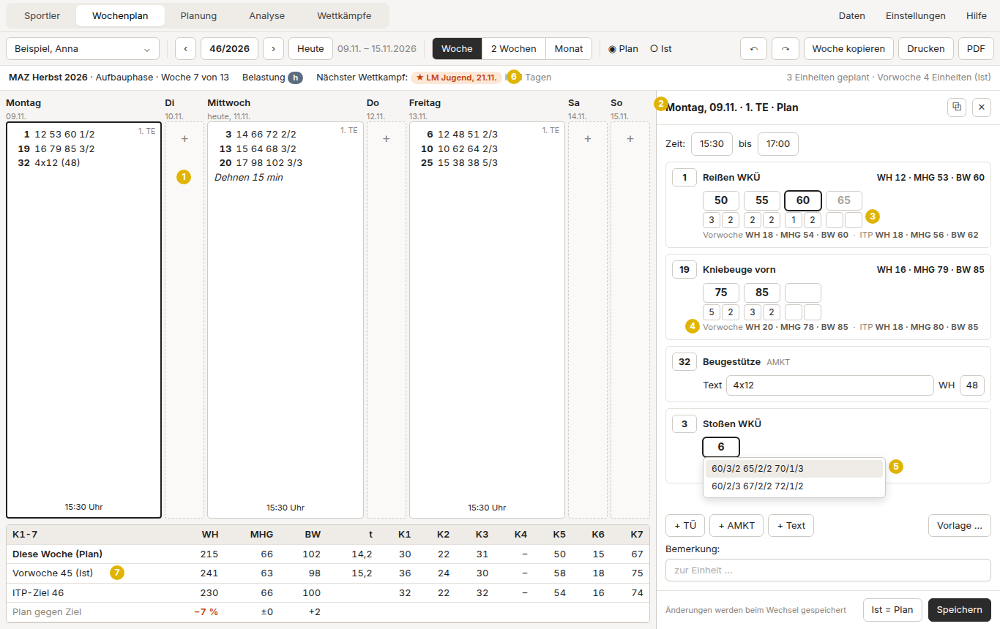
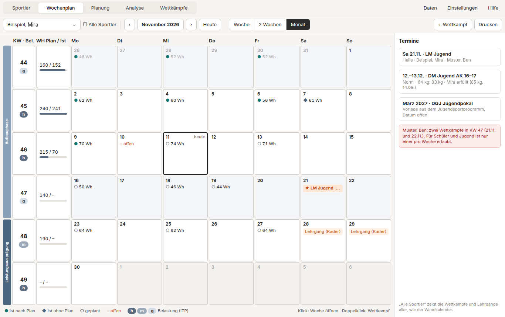
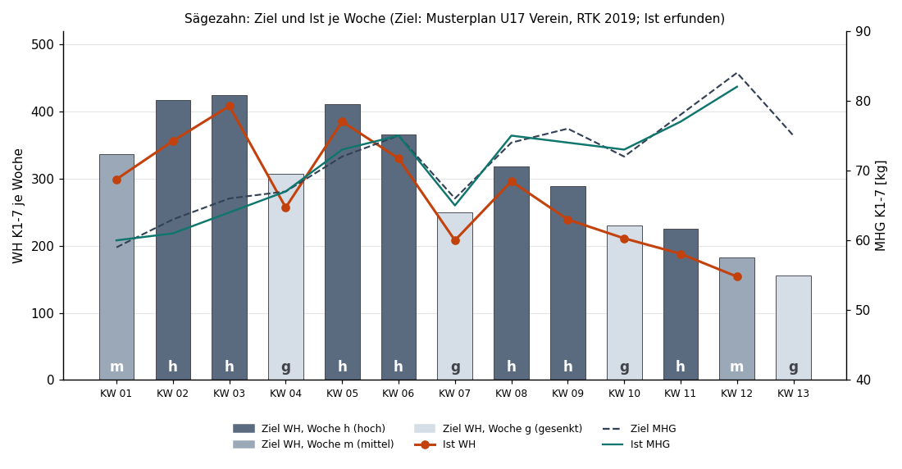
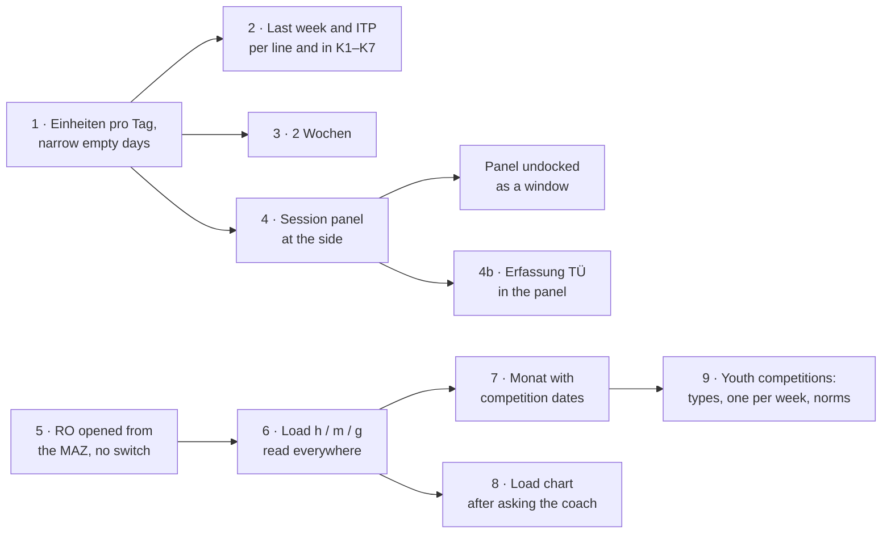

# UI/UX plan

How the Trainingsplaner should support a weightlifting coach in planning
and recording training, and in which order to build it. Everything
learnt so far is collected here: the coach's wishes, the old program
WinWoTA XP, its web successor IDA, the BVDG's and the DGJ's rules, and
what open-source training programs do.

The mock-ups and charts in `docs/ux/` show invented athletes and numbers
only.

**Contents**

1. [The coach and his work](#1-the-coach-and-his-work)
2. [Principles](#2-principles)
3. [The screens](#3-the-screens)
4. [Entering data quickly](#4-entering-data-quickly)
5. [What other programs do](#5-what-other-programs-do)
6. [What the federations' rules add](#6-what-the-federations-rules-add)
7. [Order of work](#7-order-of-work)
8. [Ideas set aside](#8-ideas-set-aside)
9. [Questions for the coach](#9-questions-for-the-coach)
10. [Background](#10-background)

## 1. The coach and his work

The coach trains young weightlifters in a club, mostly one session a day.
He has used WinWoTA XP for years and knows it well. IDA, the IAT's web
successor, made everything more complex than he needs, so he wants a
replacement that works the way he does, with gradual improvements.

| Job | How often | WinWoTA XP | Trainingsplaner now |
|---|---|---|---|
| Plan next week's sessions | weekly | Wochenplan, Plan | Wochenplan, Plan |
| Record what was done | after every session | Wochenplan, Ist | Wochenplan, Ist; "Ist = Plan" in the menu |
| Compare with last week | while planning | switch weeks back and forth | the same |
| Keep the season's dates | weekly | not in the program: a paper calendar | not in the program |
| Plan a cycle: MAZ, RO, ITP | 2–4 times a year | Erfassung MAZ, ITP-Planung, ITP Laststufen | Planung › MAZ, ITP / RO, Laststufen |
| See the load over the weeks | weekly to monthly | ITP Planung › Grafik, Grafik | Planung › ITP › Grafik, Analyse › Grafik |
| Enter competitions | after each | Erfassung Wettkämpfe | Wettkämpfe |
| Analyses | after a cycle | one window each | Analyse, 4 tabs |

Planning a week and recording it are by far the most frequent jobs; they
decide how the program feels. That is where his wishes are, too:

| # | What he asked for | Where in this plan | State |
|---|---|---|---|
| W1 | See the previous week while entering a session | 3.1, 3.2 | done |
| W2 | As many sessions per day as he uses (one), not always two | 3.1 | done |
| W3 | Two weeks at once when there is room | 3.1 | done |
| W4 | The session editor beside the week, not over it | 3.2 | done |
| W5 | A month view with the competitions, instead of his paper calendar | 3.3 | done |
| W6 | A chart of Ist against Ziel showing raised and lowered weeks | 3.5 | built, to confirm with him |
| W7 | The next weight filled in by the athlete's usual jump | 4 | done |
| W8 | WH (ges.) of an AMKT line from its text (4x12) | 4 | done |
| W9 | Earlier entries offered while typing | 4 | done |
| W10 | ↑ / ↓ to count reps, sets and failed attempts | 4 | done |
| W11 | No placeholder "1" in the sets field | 4 | done |
| W12 | "von" never after "bis" | 4 | done |
| W13 | ITP and Rahmenorientierung not behind one switch | 3.4 | done |
| W14 | A print preview before printing, as WinWoTA's Seitenvorschau | – | done |
| W15 | Projects: one file each, opened, created and copied from one menu, a dumbbell icon without label, left of the tabs, which also holds Daten, Einstellungen and Hilfe | – | done |

## 2. Principles

1. **Stay close to WinWoTA.** The week grid, the Erfassung windows, the
   K1–K7 summary, the printouts, the numbers and their names stay as he
   knows them. A change has to be explainable in one sentence to someone
   who knows the old program.
2. **Small steps, each usable on its own.** Every step goes to the coach
   for feedback before the next builds on it.
3. **Never hide the context.** Whatever is edited stays next to what it
   belongs to: the session next to its week, the week next to its
   targets and the week before.
4. **The program proposes, the coach decides.** Proposals (a weight, a
   total, an earlier line) are visibly different (grey, in a list), are
   taken with one key, and are never saved unless taken.
5. **Keyboard first.** Everything in the week and the session can be done
   without the mouse: arrows, Tab, Enter, ↑ / ↓ to count, Ctrl+S.
6. **The numbers trainers know.** WH, MHG, BW, SG/ANZ, K1–K7, h / m / g;
   percentages only where WinWoTA had them (framework plan, analyses).
7. **The data stays on the coach's PC**, in the old export format where
   it has a place for it.

## 3. The screens

The main areas stay as they are (Sportler, Wochenplan, Planung, Analyse,
Wettkämpfe); the changes happen inside them. A sidebar
([NAVIGATION.md](NAVIGATION.md)) is set aside until the coach has used
the steps below (section 8).

### 3.1 Woche

*Mock-up. The numbers refer to the markers.*

1. **Days share the width by their content** (done). A day without
   sessions is a narrow column with its short name, date and a "+" to add
   one; days with sessions share the rest. When even the narrow columns do not fit (two
   weeks on a small screen), the grid scrolls sideways instead of
   squeezing the text. (W2)
2. **The session panel** at the side instead of a dialog over the week:
   see 3.2. (W4)
3. **The next weight proposed** in grey: see section 4. (W7)
4. **Last week and the ITP per exercise** (done), under each line of the
   session (and in Erfassung TÜ): `Vorwoche WH 18 · MHG 54 · BW 60 · ITP WH 18 · MHG 56 · BW 62`.
   Last week means its Ist where it has one, otherwise its Plan; the
   label says which. (W1)
5. **Earlier lines offered** under the first weight. (W9)
6. **A line about the week's place in the cycle** (done; the load as
   h / m / g, its stored numbers still to confirm, question 8), from the
   MAZ and the ITP: the MAZ, the phase, the week of the cycle, its load h / m / g,
   and the next competition with the days left.
7. **The K1–K7 summary with last week and the target** (done, as a line
   under K1-7 and per complex, the difference marked from 10 %): this week (Plan
   or Ist), last week, the ITP's targets for this week, and the
   difference to the target where it is large. (W1)

**Sessions per day** (done). A setting "Einheiten pro Tag" (1, 2 or 3;
WinWoTA's default was 2, under Einstellungen › Trainingszeiten) sets how
many rows the grid shows at least; a week that uses more shows them all,
so nothing is ever hidden. The "3 TE" box is gone. A day gets a further
session from its context menu ("Weitere Einheit an diesem Tag").
Sessions keep their numbers 1–3, as in the old export format. (W2)

- **With 2 or 3** the rows are the session numbers, as in WinWoTA: the
  1. TE (morning) above the 2. TE (afternoon).
- **With 1** each day lists its own sessions from the top, whatever their
  number, with the number in the cell's corner. A single session is
  often a 2. TE in WinWoTA's data (the afternoon); it no longer leaves an
  empty row above it. A new session on an empty day gets the number the
  week uses most (else the week before), so the times from the settings
  fit.
- **Plan and Ist count together**: in the Ist, a planned session keeps
  its place and its day stays wide, ready for its Ist.

**Two weeks** (done). "Vorwoche" in the toolbar, where WinWoTA had its
"3 TE" box, shows the week before above the week, dimmed and labelled
(`Vorwoche 45/2026 · Ist`, its Plan when it has no Ist), in the same
columns; the choice is kept. It is read only: a click into it switches to
that week as shown. With one row per day and narrow empty days there is
room for both; with two rows each the cells get small, and the time of a
session is left out where it would cover its lines. When the month view
comes, "Woche | 2 Wochen | Monat" can replace the box. (W3)

**Plan and Ist** stay two weeks, switched as now, as in WinWoTA. A planned
session in the past without an Ist is marked "offen" (in the month view
too), and "Ist = Plan" turns it into its Ist with one click, ready to
correct what differed. No new states or workflow.

### 3.2 Trainingseinheit (the session panel)

Done. The session dialog was modal and covered the week; it is now a
panel at the side of the week, like a property editor (marker 2 in the
mock-up), in a split the coach can widen or narrow:

- **Selecting a session** (click, or arrow keys and Enter) shows it in
  the panel; the selected cell is framed. The week stays fully visible.
- **The panel has WinWoTA's lines**: TÜ with weight steps, AMKT with text
  and WH (ges.), free text; "+ TÜ", "+ AMKT", "+ Text" add one; the time
  "von – bis" and the note below. Each line shows its WH, MHG and BW, and
  under it last week and the ITP (W1).
- **Saving**: changes are saved when another session is selected, the
  week changes or the panel is closed (×, Esc), and can be undone as
  today (Ctrl+Z). A small note in the panel's foot says so; "Speichern"
  (Ctrl+S) saves at once. A session that cannot be saved (an impossible
  time) keeps the panel on it and says why.
- **Each line in two rows**, to fit: the exercise with its buttons, then
  its weights or text, and under the weights the session's figures (the
  week's in brackets, as WinWoTA's "TE (WO)") beside last week and the
  ITP. Tab goes from the exercise straight to its weights.
- **"Ist = Plan"** in the panel's foot, for the Ist week.
- **Undocking**: the panel can be taken out into a movable window, for a
  second screen or a small one, and remembers where it was. Closed, the
  week takes the whole width again.
- **"Wie Vorwoche"** in an empty session takes the lines of the same
  session last week (its Ist, else its Plan). WinWoTA had "Woche
  kopieren" only. Taking an earlier session by date is left for later.

**Erfassung TÜ in the same panel** (done). Erfassung TÜ, opened by
clicking an exercise line, edits one exercise across the week: one row
per session it is in, with that line's weight steps; the day and TE of a
row move the line to another session, "Einheit hinzufügen" puts the
exercise into one more session, the bin takes it out of one. It was a
dialog over the week; it is now the panel's second view, with the same
entry help, the week's figures for the exercise, last week and the ITP.
The panel shows either a session or an exercise; switching saves.

**What the panel changes is shown in the week**, and said in one line
under its title:

- the session panel tints and frames its session ("Ändert diese
  Trainingseinheit");
- Erfassung TÜ outlines the exercise's lines in every session and fades
  all other lines ("Ändert Übung 1 in allen Einheiten dieser Woche");
  the row under the pointer tints and frames its session.

### 3.3 Monat

Done, as "Woche | Monat" in the week's toolbar (the view is kept;
"Vorwoche" stays a box beside it). Ctrl+←/→ go by months there.

*Mock-up.*

The coach keeps the season on a paper calendar: the competitions, and an
overview of the training. Neither WinWoTA nor the Trainingsplaner has
one; WinWoTA's calendars were date pickers only. (W5)

- **Weeks as rows** with their number, the load h / m / g from the ITP,
  and WH planned / done with a bar. Lowered weeks are shaded. The MAZ's
  phases run down the left edge. Clicking a week opens it.
- **Days** show their sessions in four states, as in GoldenCheetah's plan
  calendar: done as planned (Ist with a Plan, its WH), done without a
  plan, planned, and "offen" (planned, in the past, without Ist).
- **Competitions are entered here as dates** ("+ Wettkampf", or a double
  click on a day): date, name, place, type. They are the same records as
  on the Wettkämpfe page, with the attempts still empty; the results are
  added there afterwards. A competition date can set the ITP's "WK"
  column (competition position) of its week, which today is typed by
  hand.
- **Termine** at the side: the coming competitions, with the DM norm
  where one applies (section 6), and warnings such as two competitions
  in one week for a youth athlete.
- **"Alle Sportler"** shows everyone's competitions, the page that
  replaces the calendar on the wall. **Drucken** prints the month on A4
  landscape.
- Camps and tests (the "Lehrgang" in the mock-up) only if the coach
  wants them (section 9); they would be a new kind of record, and are
  not built.
- **Printing** puts the month on paper as a table: a row per week with
  KW, load and reps, a cell per day with its sessions and competitions.
- The DM norm and the one-per-week warning in "Termine" come with the
  youth competitions (step 9).

### 3.4 Planung: MAZ, Rahmenorientierung, ITP, Laststufen

Today the tabs "ITP / RO" and "Laststufen" both switch between "ITP" and
"Rahmenorientierung" with a radio button, although the two belong to
different things:

- the **Rahmenorientierung** (RO, framework plan) belongs to a MAZ, for
  the whole group, in percent of the target performance;
- the **ITP** belongs to one athlete in a MAZ, in kg.

With "Rahmenorientierung" chosen, the athlete box beside it still shows
an athlete, although it means nothing then. WinWoTA had no such switch:
the framework plan was opened from the MAZ ("Erfassung MAZ ›
Rahmenorientierung"), the ITP from the ITP menu, each in its own window.
(W13)

So, as in WinWoTA (done):

- **Planung › MAZ** keeps its button "Rahmenorientierung", which opens
  the framework plan of the selected MAZ as a view of its own: "‹ MAZ"
  back, "Rahmenorientierung", and its two views "Werte" (WH per complex,
  MHG and BW in %, load) and "Laststufen" (planned weight steps in %),
  with only a MAZ to choose.
- **Planung › ITP** and **Planung › Laststufen** are the athlete's, in
  kg, without the switch: an athlete and one of their MAZ (or an own
  range) to choose. A link from the ITP to its MAZ is left for later.
- **The load of a week** (h / m / g) is set in the RO and the ITP, in
  the "Bel." column, typed as h, m or g (done); everything else reads it
  from there: the week's info line (done), the month view and the load
  chart (when they come).

### 3.5 Belastungsverlauf: Ist against Ziel

He described a chart of Ist against Ziel where the raised and lowered
weeks (gehobene / gesenkte Wochen) show as a sawtooth. (W6)

*Mock-up: the targets are the RTK's sample plan U17 Verein (weeks 1–13 of
2017, snatch and K1-7); the Ist is invented, up to week 9.*

What the sawtooth is, from the RTK's sample plans:

- High-load weeks (h) alternate with lowered weeks (g). The plans for U15
  and U17 all run `m h h g h h g h h g h m g`.
- **The weight climbs in a sawtooth**: MHG and BW rise towards the
  competition, with a dip in the lowered weeks. In the U17 plan the
  snatch's BW goes 70 → 83, down to 78 in week 7, 88 → 90, down to 85 in
  week 10, then 95 → 100.
- **The reps fall in a sawtooth**: a lowered week has about two thirds of
  the reps (K1-7) of the high weeks before it (most between 55 and 75 %),
  and the reps fall over the cycle as the weight rises.

The chart:

- **Weight is the main series**, for one exercise: BW and MHG per week,
  the ITP's target dashed, the Ist solid; lowered weeks shaded.
- **An ideal line** for each: straight from the first week's Ist to the
  target of the last week (or the MAZ's Zielleistung, or the competition
  date; to decide with the coach). It shows at a glance whether the
  athlete is ahead of or behind the straight way to the goal, while the
  planned sawtooth swings around it.
- **Reps below**, small: the target WH (K1-7) per week as pale bars with
  h / m / g, the Ist as dots.
- **Bezug** as in WinWoTA's Grafik: absolute kg, % of the MAZ target
  (MAZ-Ziel), or % of the competition result the MAZ started from
  (MAZ-WK).
- **Today** marked; after it the expected course, as in GoldenCheetah:
  the weeks already planned (Plan), then the ITP's targets.
- **A table below the chart** with the same numbers per week (Ziel, Plan,
  Ist, difference), to copy and print, as wger shows its statistics.
- **Compare with another MAZ** (last year's cycle), as WinWoTA's "ITP
  Planung" chart did ("Vergleich MAZ: RO / ITP / IST").
- **Opened from the week** (the current week marked) and from Analyse,
  not only from inside the ITP.

Built ("Belastungsverlauf", replacing Planung › ITP › Grafik): opened
with "Verlauf" in the week (on the week's MAZ, or twelve weeks around
it), with "Grafik" in the ITP and "Belastungsverlauf" in Analyse. It
draws the weight of one exercise and the reps of K1-7 as described
above, in kg or % of the MAZ target or MAZ-WK, with today marked, the
weeks planned after it thin, a tooltip per week, and the table below
to copy and print. Not built yet: the comparison with another MAZ, and
saving the chart as an image. Whether it is what the coach described
is still to ask him (section 9, question 1).

### 3.6 Wettkämpfe

- **Coming competitions** (dates entered in the month view) at the top of
  the list, results below as now.
- **Youth competitions** of the DGJ to pick (done): offered as names
  while typing a competition (with the month they usually are in), each
  mapped onto one of WinWoTA's types (NT, DM, IT …), so the old export
  format keeps its meaning.
- **The DM Jugend norm** of the athlete's weight class (done): in the
  page's toolbar for a youth athlete ("AK 16 · -89 kg · Norm DM Jugend
  -89 kg: 188 kg – noch 14 kg"), at a DM in the month's dates and in the
  competition dialog. The weight class comes from the MAZ, else from the
  last body weight at a competition. The norms are an editable table
  under Einstellungen › Normen, the DGJ's of 2020 until changed. A norm
  line in the competition chart is left for later.
- **One competition per week** for youth athletes up to AK 17 (done): a
  warning in the competition dialog and at the dates in the month view;
  saving is still allowed.
- The "Bild" and "Drucken" buttons move into the toolbar, as in Analyse.

### 3.7 Analyse

Already as WinWoTA's analyses, but live (no "Tabelle" button), with the
tables in WinWoTA's style, copy, print and save as PDF or CSV. Changes:

- The load chart (3.5) is reachable from here.
- WinWoTA's "Langfristiger Leistungsaufbau" (long-term development) has
  no counterpart yet; what it showed is to be found out on the old PC
  (section 9).

### 3.8 Printing

- **The week plan** as now (WinWoTA's layout, paper and orientation in
  the settings).
- **The month** on A4 landscape (3.3).
- **The session panel** prints the session alone, for the athlete's
  pocket, if the coach wants it.

## 4. Entering data quickly

What is done (W7–W12), and the rules behind it, which the session panel
and every later form follow:

- **Next weight proposed.** A weight typed into a step proposes the next
  one: plus the jump the athlete usually makes in that exercise, learnt
  from their lines of the last half year (the most frequent rise between
  neighbouring steps; their jumps in any exercise when they have none for
  this one; 5 kg without any). The proposal is grey, follows the step
  before until it is typed over or gets its reps, and is not saved on its
  own. WinWoTA had one global "Steigerung" (2.5 or 1.0 kg) for everyone;
  no rule per athlete exists in the RTK or the DGJ's programme.
- **Counting with the arrows.** ↑ / ↓ in a weight go to the next weight
  by the step from the settings; in reps, sets and failed attempts they
  add or take one.
- **Totals from text.** WH (ges.) of an AMKT line follows its text: 4x12
  gives 48, 3x10 + 2x8 gives 46, 4xMax nothing. A total typed by hand
  stays.
- **Earlier entries offered** while typing: the athlete's earlier lines
  of the exercise under the first weight, earlier texts of an AMKT
  exercise, earlier notes. ↓ / ↑ and Enter or a click take one; Esc
  closes the list.
- **Empty means the default.** An empty sets field counts as one set, as
  in WinWoTA; it shows no placeholder.
- **Ranges stay in order.** "von" never after "bis": when an edit puts one
  past the other, the other follows and keeps the span.

Next in the same spirit:

- **"Wie letzte Woche"** for a whole session: the lines of the same
  weekday last week as a proposal (W1), from the panel's "Vorlage …".
- **A line typed as notation**: `70/3/2 80/2/2 85/1/2` typed or pasted
  into a line fills its steps, as the Laststufen tab already reads it
  (Liftosaur's idea).
- **"Für die restlichen Laststufen"**: in the Ist, a changed reps or sets
  value can be applied to the remaining steps of the line with one key
  (LiftLog's "this set / remaining / all").
- **Percent help** in the steps: hovering a weight shows its percent of
  the athlete's target (MAZ-Ziel) and of the ITP's BW for the week.

## 5. What other programs do

Open-source programs for planning and recording strength training,
checked in November 2026 against their repositories, documentation and
source code. None is made for a weightlifting coach planning cycles for
a group; none uses WH / MHG / BW or K1–K7. They are useful for single
patterns.

| Program | Licence, platform | What is worth learning |
|---|---|---|
| [GoldenCheetah](https://github.com/GoldenCheetah/GoldenCheetah) | GPL-3.0, Qt desktop (endurance sports) | A plan calendar (month, week, day) with four states: planned only, planned and done, done without a plan, missed. Phases and events in the calendar. "Repeat plan" copies a range to new dates; inserting a rest day shifts everything after it. An "expected" load chart: actual data up to today, planned data after it. Athlete tiles with planned against done. |
| [wger](https://github.com/wger-project/wger) | AGPL-3.0, web and mobile | Statistics as a table and a chart of the same numbers, grouped per week, cycle or exercise. Routines printed as a multi-week table and as a sheet to write on. Trainers can open a member's account. |
| [Liftosaur](https://github.com/astashov/liftosaur) | AGPL-3.0, web and mobile | Plans typed in a short notation close to WinWoTA's (`3x5 80%`) with autocomplete in the editor; weights rounded to what can be loaded; last and best results shown beside a planned set. |
| [LiftLog](https://github.com/LiamMorrow/LiftLog) | AGPL-3.0, mobile | Recording as "confirm unless different": one tap logs the planned set, only differences are typed. A changed weight asks whether it applies to this set, the remaining sets or all. |
| [Flex](https://github.com/brandonp2412/Flex) | MIT, Android and Windows | Each exercise shows the sets of the last session to compare with. |
| [streprogen](https://github.com/tommyod/streprogen) | GPL-3.0, Python library | Turns percentages and a start weight into a plan in kg with rounding, with sawtooth progression and deload weeks; prints sheets for the gym. A model for RO → ITP. |

No open-source coach–athlete planner or percentage-table (Prilepin) tool
of any maturity was found.

**Taken into this plan:**

1. **Last time beside the plan** (Flex, Liftosaur): last week and the ITP
   under each exercise line (3.1, marker 4).
2. **Recording as "confirm unless different"** (LiftLog, GoldenCheetah):
   "Ist = Plan", then correct (3.1); in the Ist, a changed weight or reps
   can be applied to the remaining steps of the line (4).
3. **The notation as an entry** (Liftosaur): a line of steps can be typed
   or pasted as `70/3/2 80/2/2` (4), as the Laststufen tab already does.
4. **A calendar with four states** (GoldenCheetah): planned, done, done
   without a plan, "offen" (planned, past, without Ist); phases as bands,
   competitions as markers (3.3).
5. **The expected course** (GoldenCheetah): in the load chart, the Ist up
   to today, then the planned weeks already entered, then the ITP's
   targets (3.5).
6. **Table and chart of the same numbers** (wger): the load chart has its
   table below, to copy and print (3.5).
7. **Shifting and repeating** (GoldenCheetah): move a session to another
   day by dragging it; repeat a week to the next weeks (later, 8).
8. **Athletes at a glance** (GoldenCheetah): one tile per athlete with
   this week planned against done, for coaches of a group (later, 8).

**Not taken:** progression scripts and rule chains (Liftosaur, wger: too
abstract; the coach steers by hand, helped by proposals); mobile habits
(swiping, rest timers, tap-to-count circles); streaks, record fanfares
and social feeds; body maps and muscle-group volume (bodybuilding, not
weightlifting); customisable dashboards.

## 6. What the federations' rules add

### 6.1 BVDG Rahmentrainingskonzeption 2019 (RTK)

The framework concept sets how training is planned: framework plan (RO,
per age group, in %) → individual plan (ITP, per athlete, in kg) → week
plan. What the program uses from it:

- **Which target a percentage refers to** (p. 57): wide-grip exercises
  refer to the snatch target, narrow-grip exercises and squats to the
  clean & jerk target. Used when the ITP is made from the RO.
- **The load levels** h / m / g and the pattern of the sample plans
  (3.5).
- **75 sample weeks** printed by WinWoTA, against which WH, MHG, BW,
  K1–K7 and tonnage are checked (`tests/fixtures/`, `tst_core`).

### 6.2 DGJ Jugendsportprogramm (status 15 January 2020)

The programme sets the youth competitions of the German Weightlifting
Youth (DGJ). What a coach of young athletes can use in the program:

| Rule in the programme | Use in the Trainingsplaner |
|---|---|
| The year's national youth competitions and their months (table 1): DM Schüler AK 13–15 (November), DM Jugend AK 16–17 (December), DGJ Schülerpokal AK 12–14 and Jugendpokal AK 15–17 with the Länderpokale (March), regional Mehrkampf championships AK ≤ 15 and IDJM AK 15–17 (June) | Competition types to pick; a template for the season's dates in the month view |
| Only one competition per week for Schüler and Jugend (up to AK 17) | A warning when a second competition is entered in the same week for an athlete of that age |
| DM Jugend: a norm per weight class, AK 16–17, total in kg reached between 1 January and the entry deadline (e.g. boys −89 kg: 188 kg, girls −64 kg: 83 kg) | A norm line in the competition chart; "Norm erreicht am …"; the norm in the month view's Termine |
| DM Schüler: a norm in total technique points (AK 13 / 14 / 15: boys 180 / 200 / 220, girls 170 / 180 / 190) | Only with technique marks entered (next row) |
| Schüler score per lift: kg × 50 / body weight + technique mark × 10; the mark 0–10 in steps of 0.5 | Optional technique mark per attempt on the Wettkämpfe page, points worked out |
| Athletic tests with point formulas: Schlussdreisprung (cm × 0.2), Pendellauf ((13 − s) × 20 + 100), 30-m-Sprint ((6 − s) × 40 + 100), Schockwurf (cm × 7.5 / body weight), Anristen, Klimmziehen, Zug liegend, Bankdrücken, Liegestütze, Beugestütze; sums × 0.5 (four tests) or × 0.66 (three) | Test results as extra info per athlete (as body weight is now), points worked out, a chart over time |
| Weight classes per age class (Schüler AK 13–15, Jugend AK 16–17, best lists from AK 10) | The weight class box on the athlete form lists those of the athlete's age class |
| Boys lift with the 15 kg bar up to AK 14, then 20 kg; girls always 15 kg | The bar for plate loading in a later competition planner |

Norms and dates change, so the program keeps them as editable tables (as
WinWoTA's "Normen"), not built in. Which rows matter depends on the
coach's athletes: technique and athletic points only concern Schüler and
Mehrkampf competitions.

## 7. Order of work

| Step | What | Size | For |
|---|---|---|---|
| ✓ | Next weight proposed, ↑ / ↓ counting, totals from text, earlier entries, no placeholder, ranges in order | – | W7–W12 |
| ✓ 1 | Setting "Einheiten pro Tag"; rows grow with the data; "Weitere Einheit"; "3 TE" goes; empty days narrow, scrolling when too wide | small | W2 |
| ✓ 2 | Last week and the ITP per exercise line in the session editor; last week, target and difference in the K1–K7 summary; the info line of the week | small | W1 |
| ✓ 3 | "Vorwoche": the previous week above the current one | medium | W3 |
| ✓ 4 | Session panel at the side of the week, undockable; "Wie Vorwoche" | medium | W4 |
| ✓ 5 | Rahmenorientierung opened from the MAZ; ITP and Laststufen without the switch | small | W13 |
| ✓ 4b | Erfassung TÜ as the session panel's second view; what the panel changes marked in the week | medium | W4 |
| ✓ 6 | The week's load h / m / g read from the ITP wherever a week is shown | small | 3.1, 3.3, 3.5 |
| ✓ 7 | Monat: weeks with load and WH, sessions, competition dates, Termine, all athletes, print | large | W5 |
| ✓ 8 | Load chart: weight as Ziel, Ist and ideal line, expected course, reps with h / m / g, table below, Bezug, reachable from week and Analyse (comparison MAZ later) | medium | W6 |
| ✓ 9 | Youth competition types, one-per-week warning, DM norms as an editable table | small | 6.2 |

Steps 1, 2 and 5 are small and independent; each can go to the coach on
its own. Step 4 builds on the narrow days of step 1. Step 8 waits for his
answers (section 9).

## 8. Ideas set aside

Kept for later, and only if the coach wants them:

- **One sidebar instead of the two tab bars** ([NAVIGATION.md](NAVIGATION.md)).
  A larger change in how the program is found; not before he has used
  the small steps.
- **Plan and Ist as one session with "Bestätigen"**, as in IDA. He chose
  WinWoTA's way over IDA's; "offen" and "Ist = Plan" (3.1) cover the
  useful part.
- **An Übersicht start page** and **the ITP as a timeline** of phases,
  load and events. The month view gives most of this in a form he
  already uses on paper.
- **Moving and repeating**: drag a session to another day in the week or
  the month; repeat a week to the following weeks (GoldenCheetah). Today
  copy and paste do this.
- **Athletes at a glance**: a tile per athlete with this week planned
  against done, for a coach with a group (GoldenCheetah's athlete view).
- **Sessions shared by several athletes**, and athletes entering their own
  Ist on the phone (ROADMAP phase 4).

## 9. Questions for the coach

1. The load chart (3.5): weight first, as in the mock-up, or the reps? Is
   "Ziel" the ITP in kg or the framework plan? One exercise at a time or
   several? Where should the ideal line end: the last week's target, the
   Zielleistung or the competition? Did he draw the plan into WinWoTA's
   chart by double-clicking, or only look at it?
2. What does "TÜ und WKT" mean: exercises and competition exercises
   (WKÜ), or also competition dates?
3. A photo of a month of his paper calendar: what is on it besides the
   competitions (camps, tests, school holidays, the load of the week)?
4. Which age groups does he coach? That decides which rows of 6.2 are
   worth building.
5. "Alle Sportler" in the month view: all athletes, or those of one MAZ?
6. The session panel: at the side, or below the week as WinWoTA's
   summary page was?
7. What did WinWoTA's "Langfristiger Leistungsaufbau" show, and does he
   use it? (To look at on the old PC.)
8. Which values does WinWoTA's "Bel." (load of a week, a small number
   in the data, TINYINT `bel`) take, and how do they map to h / m / g?
   The program assumes h = 3, m = 2, g = 1, in one place
   (`Planning::loadText`); other numbers show as they are. (To check on
   the old PC; the handoff lists the experiment.)

## 10. Background

### 10.1 Terms

| Term | Meaning |
|---|---|
| TE | Trainingseinheit, a session; up to three a day (1., 2., 3. TE) |
| TÜ | Trainingsübung, an exercise with its number from the catalogue (1 Reißen WKÜ, 3 Stoßen WKÜ, 19 Kniebeuge vorn …) |
| WKÜ | Wettkampfübung, the competition lifts |
| AMKT | general exercises described in text with a total of reps ("4x12", WH ges.) |
| Laststufe | a weight step: kg, reps per set (SG), sets (ANZ), in the Ist failed attempts (UG); written 80/3/2 |
| WH | Wiederholungen, reps: Σ reps × sets |
| MHG | mittlere Hantelgewicht, mean weight: Σ kg × reps × sets / WH, rounded half up |
| BW | Bestwert, the heaviest weight, with its reps / sets |
| K1–K7 | the complexes the exercises belong to (snatch, clean & jerk, squats, pulls …), summed per week; K1-7 and K1-5 with tonnage |
| MAZ | Makrozyklus, a cycle for a group: dates, phases (Grundlagen, Aufbau, Leistungsausprägung), athletes with targets |
| RO | Rahmenorientierung, the framework plan of a MAZ, in % of the target performance |
| ITP | individueller Trainingsplan, an athlete's targets per week and exercise in kg |
| h / m / g | load of a week: hoch, mittel, gesenkt |
| WK-Lage | position of a week relative to the competition |
| Zielleistung, MAZ-Ziel, MAZ-WK | an athlete's target in the MAZ, and the competition result it started from |

### 10.2 WinWoTA XP: its windows and where they go

WinWoTA opened every function in a window of its own from a launcher with
ten buttons (Sportler, Plan, Maz, ITP, Wettkämpfe, Analyse, Grafik, Gruppe,
Transfer, Beenden). Every editing window works the same way: the form at
the top, then "Hinzufügen / Abbruch / Löschen / Schliessen", then a list
of all records. The window definitions were read from `winwotaxp.exe`
(layout data only) and drawn as wireframes, kept outside the repository.

| WinWoTA window | Trainingsplaner |
|---|---|
| Wochenplan (7 days × 2–3 sessions, Plan / Ist, "3 TE", Bemerkung, Zusatzinfo, verletzt/krank, summary page below) | Wochenplan (3.1) |
| Erfassung Trainingseinheit (TÜ, AMKT, Text; MHG / BW / WH per line with the week's in brackets; von / bis; note) | session dialog, then panel (3.2) |
| Erfassung Trainingsübung | Erfassung TÜ dialog |
| Erfassung Zusatzinformation | Zusatzinfo dialog |
| Erfassung Makrozyklus (MAZ), (Sportler) | Planung › MAZ |
| ITP – Planung (grid weeks × exercises, Vorlage, Durchschnitt alle Wochen), ITP-Vorlage | Planung › ITP (3.4) |
| ITP – Laststufen | Planung › Laststufen |
| ITP Planung (chart: WH / MHG / BW, Vergleich MAZ RO / ITP / IST, double click adds a value) | load chart (3.5) |
| Grafik (TÜ, MHG, BW, Trend, Umfang; Ist / Plan / ITP; absolut / MAZ-Ziel % / MAZ-WK %; Wettkampf tab) | Analyse › Grafik, Wettkämpfe › Grafik |
| Individualanalyse, Gruppenanalyse, Check Trainingsdaten | Analyse |
| Langfristiger Leistungsaufbau | none yet (9.7) |
| Erfassung Wettkämpfe | Wettkämpfe |
| Erfassung Sportlerdaten | Sportler |
| Einstellungen (Steigerung 2,5 / 1,0 kg), Trainingszeiten, Einstellungen Drucken | Einstellungen |
| Daten exportieren / importieren / synchronisieren, Datenimport aus WinWoTA, MAZ/RO exportieren, Trainingsdatentransfer | Daten |
| Kalender (date pickers) | – (the month view is new) |

### 10.3 IDA

The IAT's web successor of WinWoTA (manual of May 2026). Useful single
ideas, taken where they fit WinWoTA's way:

- one timeline for the cycle: phases, weeks with h / m / g, events;
- a planned session turned into the done one ("Bestätigen"); here as
  "Ist = Plan" and "offen" (3.1);
- the section analysis with a filter on the minimum share of the week's
  best weight.

What made it too complex for the coach: events with participants instead
of a week grid, a separate confirm workflow, many levels of planning.

### 10.4 What is verified

WH, MHG and BW per exercise line, the week's figures per exercise, K1–K7,
K1-7 / K1-5 with tonnage agree with the 75 WinWoTA printouts of the RTK
2019 (7,588 checks; 17 known print errors in the sample plans). Not yet
compared with WinWoTA: the analyses, the rounding and the complexes in the
RO → ITP conversion, the competition chart. The handoff for a session on
the old PC lists the experiments (outside the repository).
